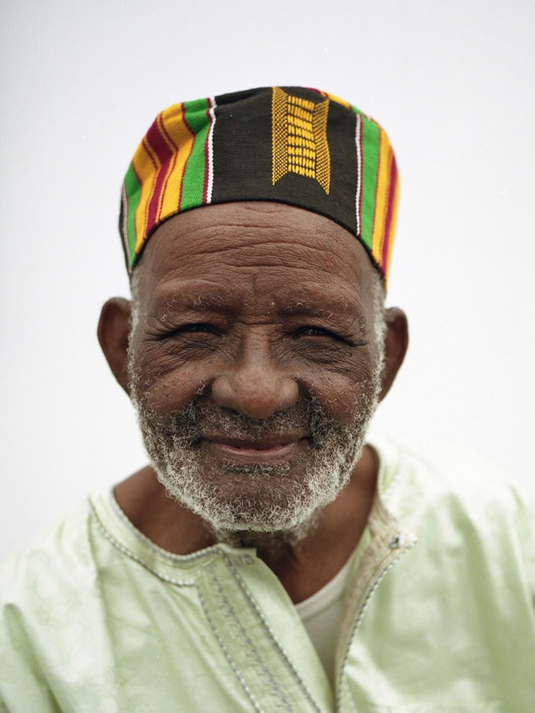
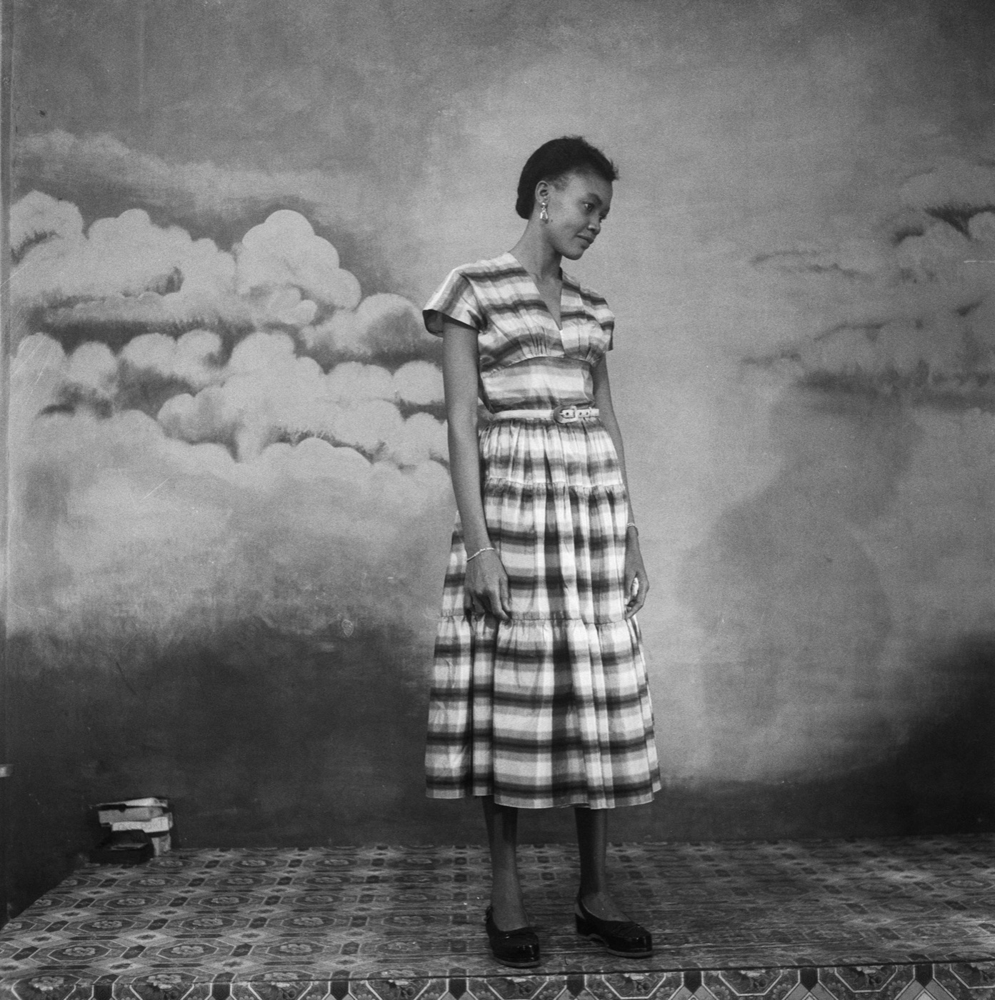
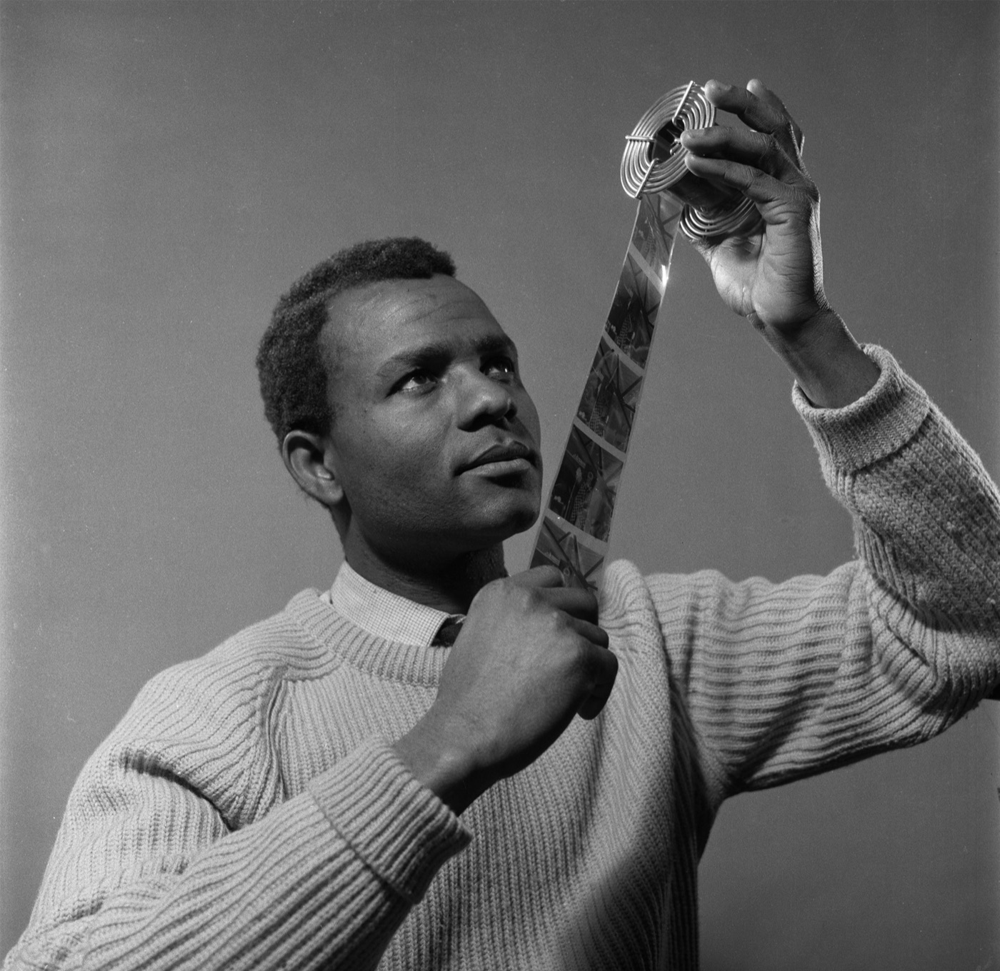
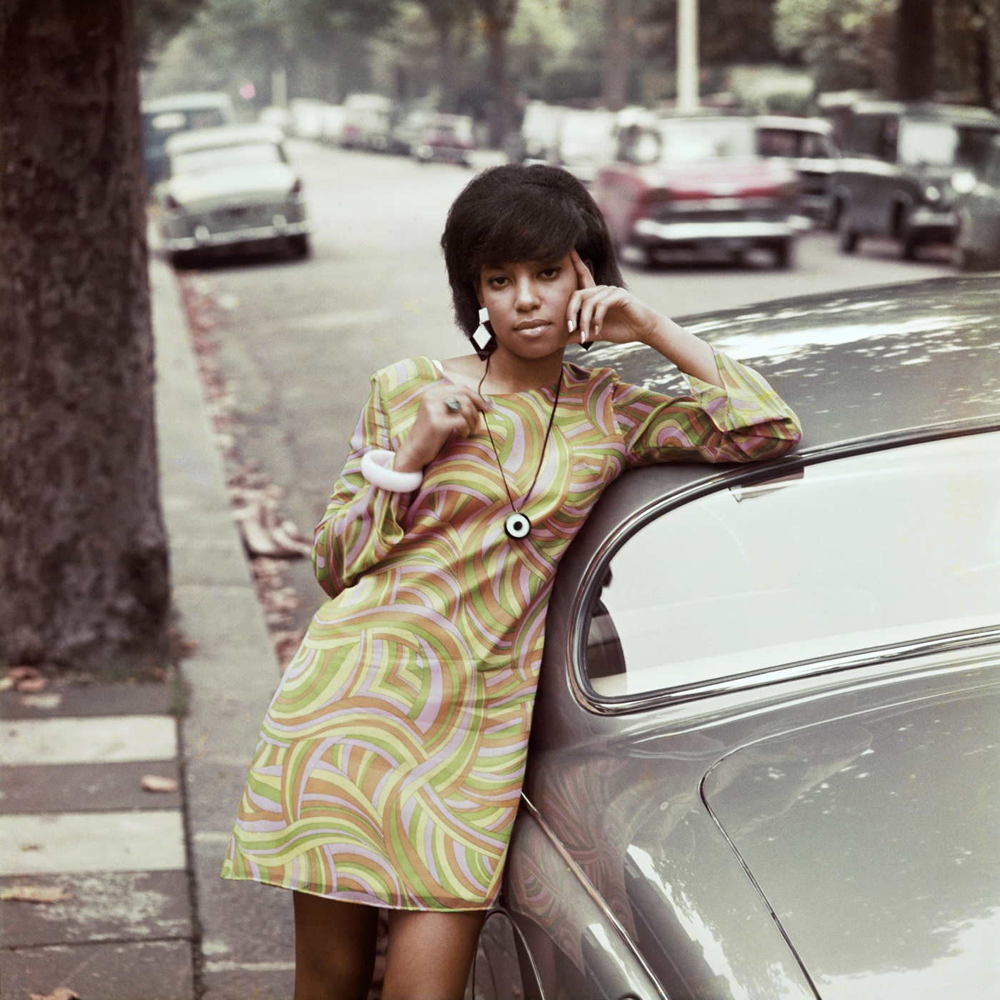
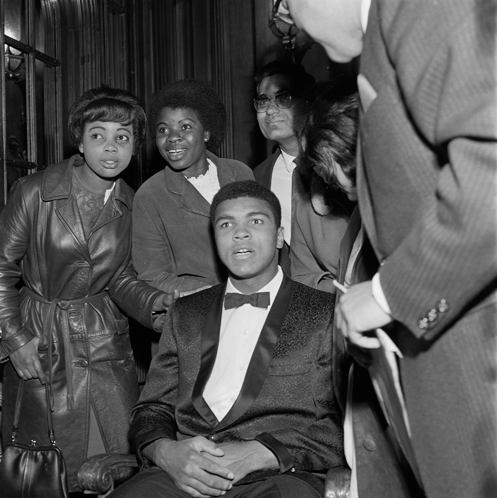
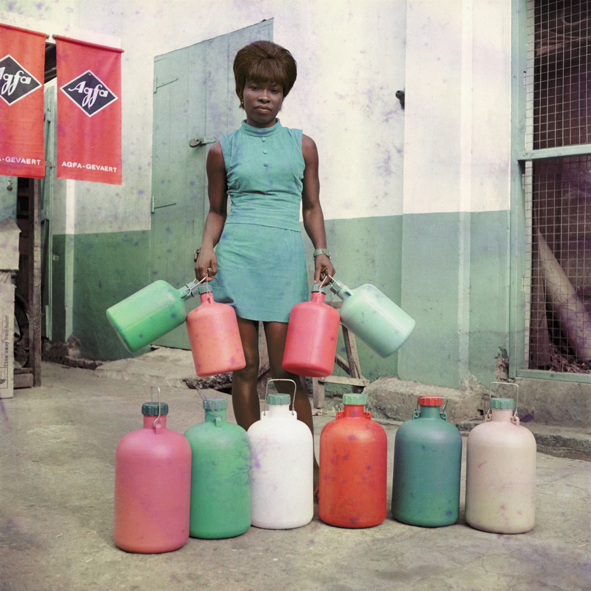
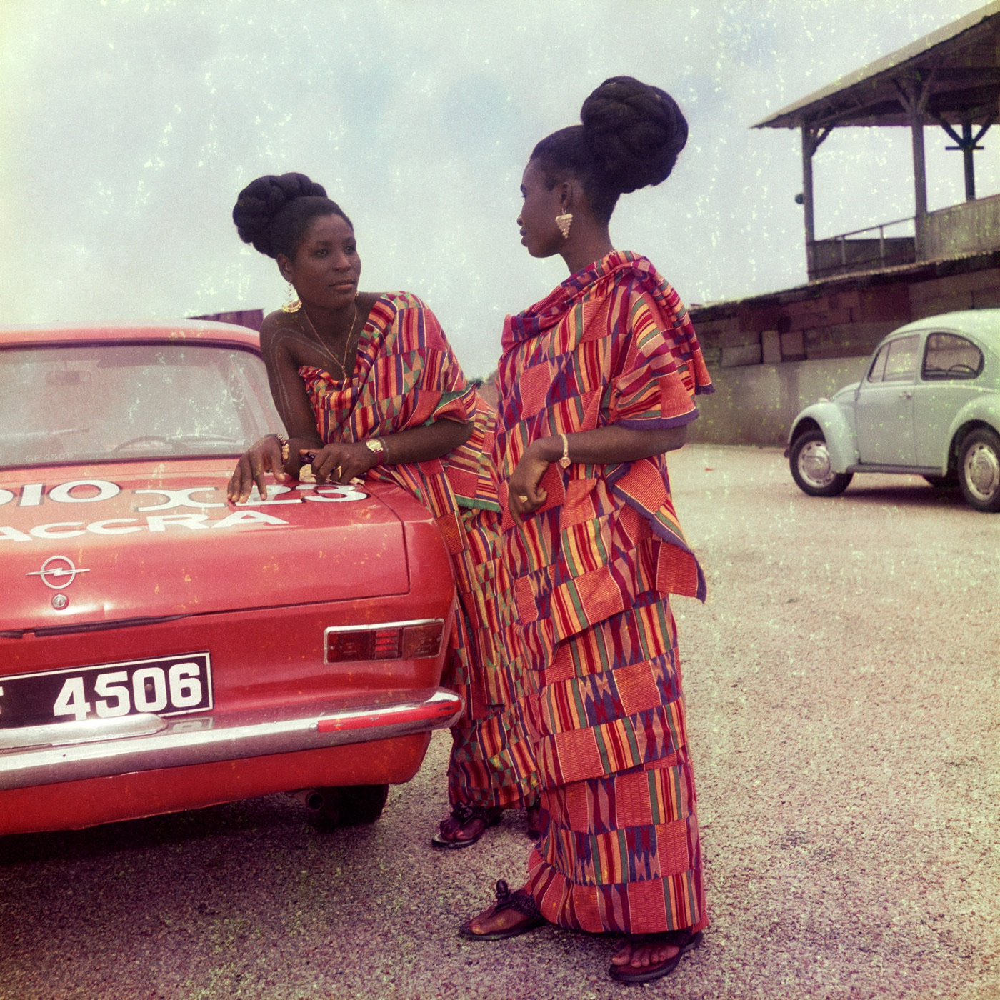

*Mike Eghan na Piccadilly Circus, Londyn, 1967. Fot. James Barnor.*

**James Barnor** otrzyma nagrodę Outstanding Contribution to Photography podczas Sony World Photography Awards 2027. 97-letni fotograf z Ghany odbierze ją na gali w Londynie 15 kwietnia 2027 roku, a od 16 kwietnia do 3 maja Somerset House pokaże retrospektywę z ponad 50 jego prac. Barnor fotografował Ghanę w drodze do niepodległości i czarnoskóre społeczności Londynu lat 60.

Poniżej znajdziesz historię fotografa, wybrane zdjęcia i informacje o wystawie.

## Dwudziesty laureat nagrody za wkład w fotografię

World Photography Organisation przyznaje nagrodę Outstanding Contribution to Photography co roku od 2008 roku. Barnor jest jej dwudziestym laureatem. Wcześniej dostali ją między innymi Martin Parr (2017), Graciela Iturbide (2021), Edward Burtynsky (2022), Sebastião Salgado (2024), Susan Meiselas (2025) i Joel Meyerowitz (2026).

„Kiedy otwierałem studio w Akrze, nawet nie przypuszczałem, że praca zaprowadzi mnie tak daleko: przez niepodległość Ghany do Londynu i z powrotem” – napisał Barnor w oświadczeniu. „Aparat stał się moim towarzyszem i nigdy tego nie żałowałem”.

*© James Barnor / Courtesy Galerie Clémentine de la Féronnière.*

## Studio Ever Young i niepodległa Ghana

Barnor urodził się w Ghanie w 1929 roku. Fachu uczył się u kuzyna, fotografa portretowego J. P. D. Dodoo. W 1950 roku został pierwszym etatowym fotografem nowego dziennika „Daily Graphic”. Bywa nazywany pierwszym fotoreporterem Ghany, a organizator konkursu pisze ostrożniej: jeden z pierwszych.

Jako fotoreporter fotografował wiece polityczne, uliczne parady i ogłoszenie niepodległości przez Kwame Nkrumaha w 1957 roku. W 1953 roku otworzył w dzielnicy Jamestown w Akrze studio Ever Young. Przed jego aparatem stawali sprzedawcy, studenci, funkcjonariusze drogówki, sędziowie i politycy. Eleganckie portrety i sceny z ulicy składają się u niego na obraz społeczeństwa, które przechodziło głęboką zmianę.

*Selina Opong, jedna z pierwszych policjantek w Ghanie, studio Ever Young, ok. 1954–1956. © James Barnor / Courtesy Galerie Clémentine de la Féronnière.*

## Między Akrą a Londynem

W 1959 roku Barnor przeniósł się do Wielkiej Brytanii. Studiował w Medway College of Art w hrabstwie Kent, gdzie poznał fotografię kolorową, a potem robił odbitki barwne w Colour Processing Laboratories.

*Medway College, Rochester, ok. 1960–1963. © James Barnor / Courtesy Galerie Clémentine de la Féronnière.*

Współpracował też z „Drum”, południowoafrykańskim magazynem o życiu czarnoskórych społeczności, znanym z krytyki apartheidu. Jego zdjęcia trafiały na okładki i do działów mody. Dla „Drum” powstał w 1967 roku kadr z okładki tego wpisu: Mike Eghan, prezenter BBC, na schodach pomnika Erosa na Piccadilly Circus.

*Erlin Ibreck, dziewczyna z okładki „Drum”, Kilburn, Londyn, 1966. © James Barnor / Courtesy Galerie Clémentine de la Féronnière.*

*Muhammad Ali wśród fanów, Londyn, 1966. © James Barnor / Courtesy Galerie Clémentine de la Féronnière.*

Na przełomie lat 60. i 70., po szkoleniach w Agfa-Gevaert w Belgii i Niemczech, wrócił do Ghany jako przedstawiciel techniczny firmy. Założył tam pierwsze w kraju laboratorium fotografii kolorowej. Na początku lat 90. znów zamieszkał w Londynie i mieszka tam do dziś.

*Asystentka Sick-Hagemeyer, Akra, 1971. © James Barnor / Courtesy Galerie Clémentine de la Féronnière.*

*Bez tytułu nr 2, dwie przyjaciółki ubrane na uroczystość kościelną, Akra, lata 70. © James Barnor / Courtesy Galerie Clémentine de la Féronnière.*

## Wystawy Jamesa Barnora

Przez ostatnie lata prace Barnora pokazywano w wielu dużych instytucjach:

- **2021:** Serpentine w Londynie, retrospektywa „James Barnor: Accra/London”.
- **2022:** LUMA Arles, „James Barnor: Stories, Pictures from the Archive (1947–1987)”, oraz MASI w Lugano.
- **2023:** Detroit Institute of Arts oraz FOMU w Antwerpii, „James Barnor, Studio of Life”.
- **2024:** festiwal „James Barnor 95” w Akrze i Tamale, z okazji 95. urodzin fotografa.
- **2025:** MoMA w Nowym Jorku, „Ideas of Africa: Portraiture and Political Imagination”.

## Retrospektywa w Somerset House

Retrospektywa będzie częścią wystawy Sony World Photography Awards w londyńskim Somerset House, od 16 kwietnia do 3 maja 2027 roku. Ponad 50 prac poprowadzi od Akry, przez Londyn i naukę fotografii kolorowej, po powrót do Ghany. Obok odbitek zobaczymy materiały archiwalne. Biletów jeszcze nie ma w sprzedaży, ale na [stronie organizatora](https://www.worldphoto.org/sony-world-photography-awards/outstanding-contribution-photography) można zapisać się na powiadomienie.

Na gali 15 kwietnia poznamy też głównych zwycięzców SWPA 2027.

Więcej o nagrodach i historii fotografii znajdziesz we wpisach o [Leica Oskar Barnack Award 2026](/blog/leica-oskar-barnack-award-2026-damir-faizulin.html), [powrocie magazynu „LIFE”](/blog/magazyn-life-wraca-do-druku.html) i [200 latach fotografii](/blog/200-lat-fotografii.html).

## Źródła

- [World Photography Organisation, Outstanding Contribution to Photography](https://www.worldphoto.org/sony-world-photography-awards/outstanding-contribution-photography)
- [Fotopolis, Krzysztof Mularczyk: SWPA 2027: James Barnor laureatem nagrody za wybitny wkład w fotografię](https://www.fotopolis.pl/inspiracje/znani-fotografowie/39983-swpa-2027-james-barnor-laureatem-nagrody-za-wybitny-wklad-w-fotografie)
- [Euronews: Seven decades behind the lens](https://www.euronews.com/2026/11/05/seven-decades-behind-the-lens-ghanas-james-barnor-receives-top-photography-honour)
- [Graphic Online: James Barnor, 97, named recipient of Outstanding Contribution to Photography award](https://www.graphic.com.gh/entertainment/showbiz-news/james-barnor-97-named-recipient-of-outstanding-contribution-to-photography-award.html)
- [V&A: Mike Eghan, Piccadilly Circus](https://collections.vam.ac.uk/item/O1243181/mike-eghan-piccadilly-circus-photograph-james-barnor)
- [Serpentine: James Barnor, Accra/London, a retrospective](https://www.serpentinegalleries.org/about/press/james-barnor-accra-london-a-retrospective/)

Fotografie pochodzą z materiałów Fotopolis.pl i należą do Jamesa Barnora oraz Galerie Clémentine de la Féronnière.
