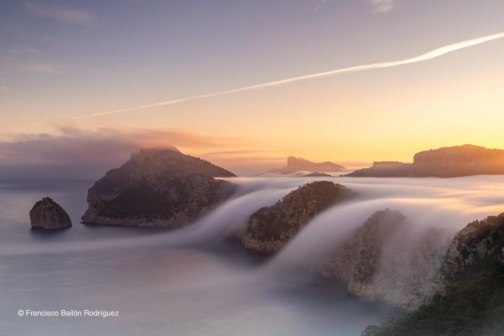
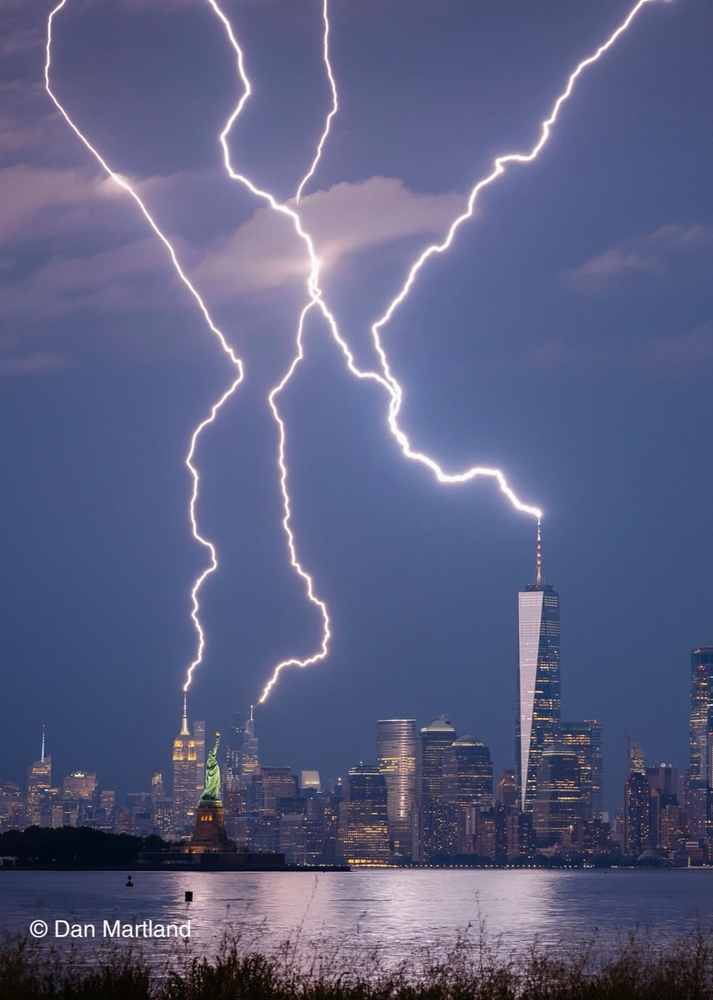
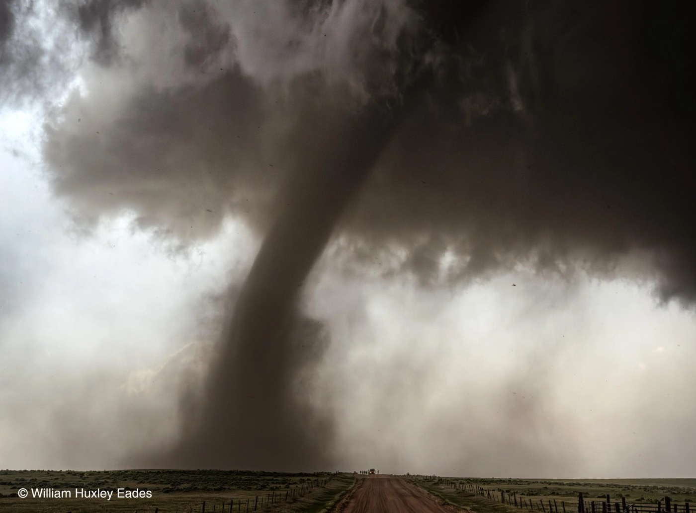
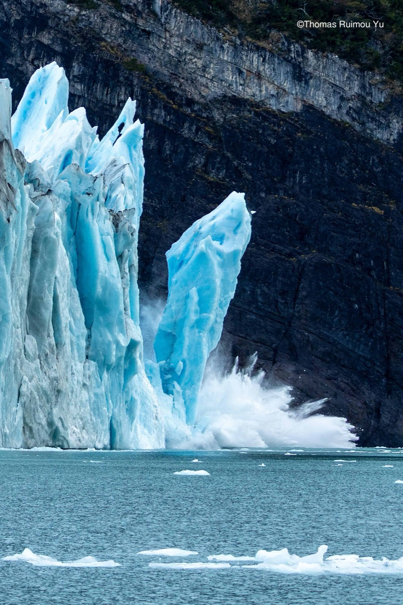
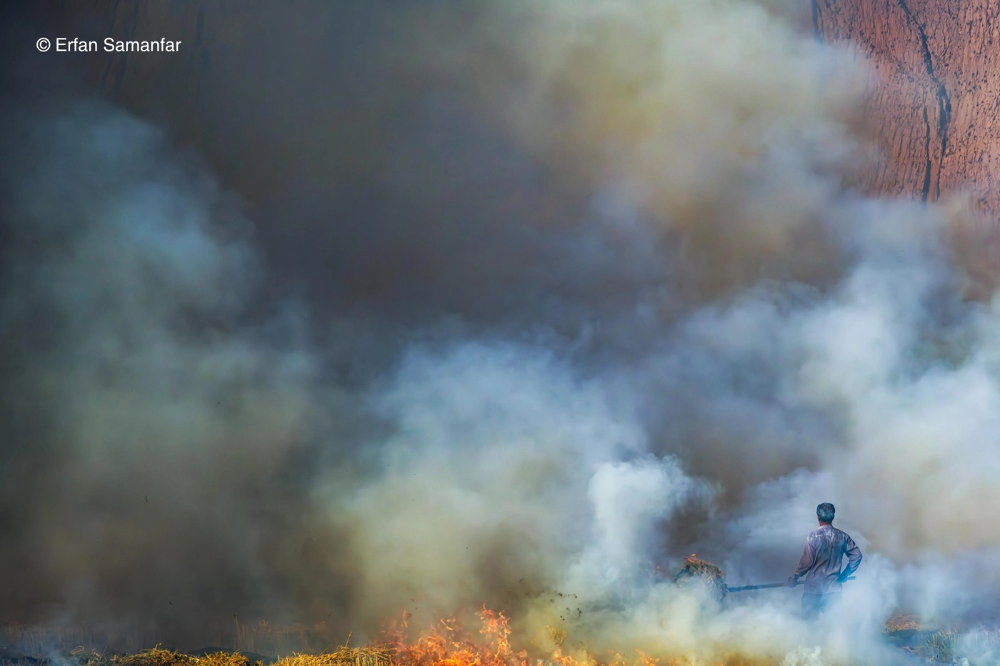
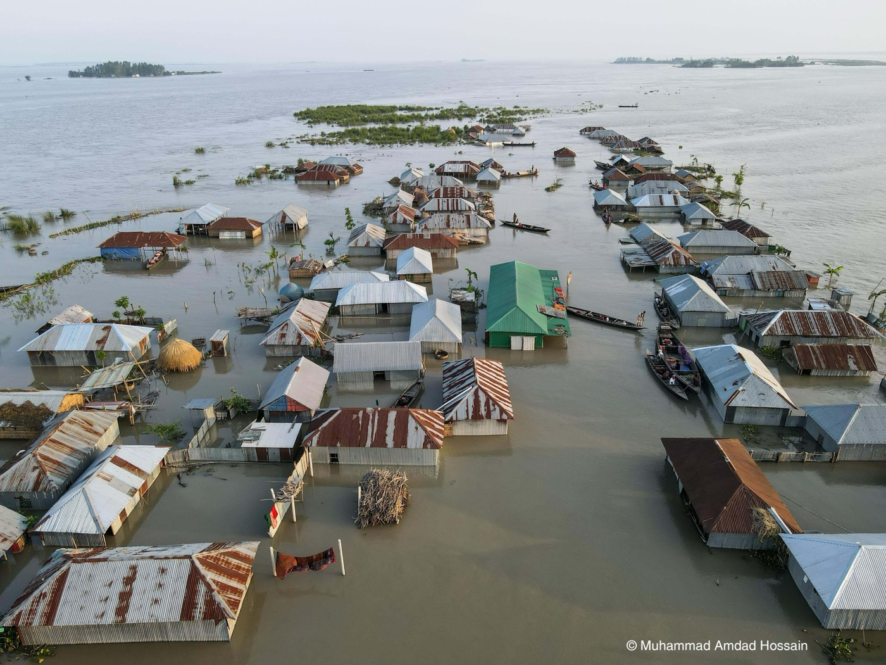

*„Mount Shasta Top Hat at Sunset”, fot. Lisa K. Kuhn. Chmury soczewkowate nad Mount Shasta o zachodzie słońca, Kalifornia, USA.*

**Weather Photographer of the Year 2026** ma 30 finalistów. Royal Meteorological Society, brytyjskie towarzystwo meteorologiczne, wybrało ich spośród ponad 5500 zgłoszeń. Zdjęcia powstały w 13 krajach. Są na nich tęcze, mgły i lodowe wzory, ale też pioruny, pożary, topniejące lodowce i zalane wsie. W finale jest też Polka, Dominika Koszowska, ze zdjęciem „Ice Hearts”.

Niżej znajdziesz najciekawsze kadry z opisami, a na końcu galerię z resztą finałowej trzydziestki.

## Konkurs, w którym główną rolę gra atmosfera

To już 11. edycja konkursu. Jury ocenia kreatywność, oryginalność ujęcia i to, co zdjęcie mówi o samej pogodzie. Nie wystarczy więc efektowny kadr, liczy się też zjawisko, które da się na nim zobaczyć i wyjaśnić. Wśród jurorów jest prof. Liz Bentley, dyrektor generalna Royal Meteorological Society.

Nagrody przyznawane są w trzech kategoriach:

- **Weather Photographer of the Year:** najlepsze zdjęcie pogody, 1500 funtów.
- **Mobile Weather Photographer of the Year:** zdjęcie zrobione telefonem lub tabletem, 500 funtów.
- **Climate Award:** zdjęcie o zmianach klimatu i ich skutkach, 500 funtów.

Osobno publiczność wybierała swojego faworyta (Public Favourite). Głosowanie skończyło się 5 listopada, a zwycięzców poznamy **17 listopada 2026 roku**.

## „Ice Hearts”: polski akcent w finale

*„Ice Hearts”, fot. Dominika Koszowska. Szadź na siatce zabezpieczającej, Bachledova dolina, Słowacja.*

Dominika Koszowska zrobiła to zdjęcie podczas zimowego wyjazdu, na ścieżce w koronach drzew w słowackiej Bachledovej dolinie, na wysokości prawie 1200 m n.p.m. Na metalowej siatce zabezpieczającej osiadła gruba warstwa twardej, białej szadzi. Lód ułożył się w powtarzalny wzór przypominający rzędy zamarzniętych serc.

„Ten dynamiczny proces fizyki atmosfery zamienił zwykłe ogrodzenie w kruchą, białą galerię sztuki” – mówi autorka, cytowana przez Fotopolis.

Szadź powstaje, gdy przechłodzone kropelki wody z mgły lub chmury osiadają na przedmiocie o temperaturze poniżej zera i niemal natychmiast zamarzają. Wiatr decyduje o kierunku, w którym narasta lód, a kształt przedmiotu o wzorze. Tutaj rusztowaniem dla lodu stała się siatka.

## Od mgły po potrójny piorun

*„Mares de niebla”, fot. Francisco Bailón Rodríguez. Mgła spływająca po klifach do morza o świcie, Majorka, Hiszpania.*

„Mares de niebla”, czyli „morza mgły”, Francisco Bailón Rodríguez sfotografował z wieży Albercutz na Majorce. Mgła i niskie chmury spływają po klifach do morza. Według opisu zjawiska sprzyjały temu inwersja temperatury i wysokie ciśnienie.

*„Triple strike NYC”, fot. Dan Martland. Trzy wyładowania nad panoramą Nowego Jorku, widok z Bayonne w New Jersey, USA.*

Dan Martland złapał w jednym kadrze trzy pioruny nad Manhattanem. Takie zdjęcie wymaga szczęścia, ale też cierpliwości, znajomości pogody i umiejętności przewidzenia, gdzie i kiedy uderzy piorun.

*„Close Enough”, fot. William Huxley Eades. Tornado z superkomórki burzowej, okolice Akron, Kolorado, USA, 23 maja 2025.*

Wśród finalistów są też tornada i superkomórki burzowe. William Huxley Eades sfotografował tornado, które sklasyfikowano później w skali EF jako EF2. Takie kadry wymagają przygotowania i ostrożności: zdjęcie nigdy nie powinno być ważniejsze niż bezpieczeństwo fotografa.

## Piękno ma też ciemną stronę

Część finalistów pokazuje skutki ekstremalnych zjawisk pogodowych i zmieniającego się klimatu: pożary, powodzie, suszę i cofające się lodowce.

*„Glacial Calving Surge”, fot. Thomas Ruimou Yu. Bryły lodu odrywające się od lodowca Perito Moreno, Patagonia, Argentyna.*

*„Fire”, fot. Erfan Samanfar. Pożar na polach koło Marwdaszt w Iranie, październik 2025.*

*„A Village Underwater”, fot. Muhammad Amdad Hossain. Wieś zalana podczas powodzi monsunowej w 2022 roku, Kurigram, Bangladesz.*

Te zdjęcia mają inny ciężar niż tęcze i poranna mgła. Pokazują, że pogoda to nie tylko widowisko na niebie, ale też zagrożenie dla ludzi, ich domów i upraw. Pojedyncze zdjęcie nie dowodzi jednak, że dane zdarzenie spowodowała zmiana klimatu. Ekstremalne zjawiska mają wiele przyczyn, a ich związek z ociepleniem naukowcy oceniają na podstawie danych i modeli. Fotografia może za to pokazać skutki takich zdarzeń i zachęcić do sprawdzenia, co za nimi stoi.

## Co mówią dane o klimacie?

Według raportu Światowej Organizacji Meteorologicznej *State of the Global Climate 2025* lata 2015–2025 to jedenaście najcieplejszych lat w historii pomiarów. Rok 2025 był drugim albo trzecim najcieplejszym, zależnie od zbioru danych, ze średnią temperaturą około 1,43°C wyższą niż w latach 1850–1900. Rekordowo dużo ciepła zgromadziły też oceany.

Ocieplenie nie sprawia, że każda burza czy fala upałów jest „winą klimatu”. Zmienia jednak warunki, w których te zjawiska powstają: może wpływać na to, jak często się zdarzają, jak są silne i jak długo trwają. Zdjęcia takie jak te z konkursu zamieniają liczby i wykresy w obrazy, które łatwiej zapamiętać.

## Jak fotografować pogodę?

Zdjęcia finalistów mogą zachęcić do własnych prób. Nie zawsze potrzebny jest najdroższy aparat, co pokazuje choćby zdjęcie z Hongkongu zrobione telefonem. Ważniejsze są obserwacja, przygotowanie i cierpliwość.

1. **Naucz się czytać prognozy.** Sprawdzaj nie tylko temperaturę i opady, ale też zachmurzenie, wiatr, wilgotność i ostrzeżenia meteorologiczne. Przy burzach korzystaj z radaru opadów, ale pamiętaj, że aplikacja nie zastąpi oceny sytuacji na miejscu.
2. **Obserwuj światło.** Mgły, promienie słońca, tęcze i dramatyczne chmury najlepiej wyglądają zwykle o wschodzie lub zachodzie. Wracaj w to samo miejsce o różnych porach.
3. **Pokaż skalę.** Chmura burzowa robi wrażenie sama w sobie, ale linia drzew, zabudowa czy górski grzbiet pozwalają pokazać jej rozmiar.
4. **Eksperymentuj z czasem naświetlania.** Dłuższy czas podkreśli ruch chmur i wody, krótszy zamrozi krople deszczu, śnieg czy błyskawicę. Statyw przyda się przy słabym świetle, ale przy szybko zmieniającej się pogodzie liczy się refleks.
5. **Dbaj o bezpieczeństwo.** Nie fotografuj burzy z otwartej przestrzeni, z grzbietów górskich ani spod pojedynczych drzew. Unikaj zalanych dróg i niestabilnych brzegów, nie zbliżaj się do pożarów ani akcji ratunkowych.
6. **Nie poprawiaj rzeczywistości.** Zdjęcie pogody ma wartość dokumentu. Jeśli dodasz chmurę albo usuniesz słup, przestaje nim być.

## Galeria finalistów

Pozostali finaliści konkursu. Kliknij zdjęcie, żeby je powiększyć i przeglądać kolejne strzałkami.

<!-- galeria -->

Zwycięzców Weather Photographer of the Year 2026 poznamy 17 listopada. O innych konkursach tej jesieni pisałem we wpisach o [Wildlife Photographer of the Year 2026](/blog/wildlife-photographer-of-the-year-2026-federico-veronesi.html), [Astronomy Photographer of the Year 2026](/blog/astronomy-photographer-of-the-year-2026.html) i [nagrodzie dla Jamesa Barnora na Sony World Photography Awards 2027](/blog/james-barnor-sony-world-photography-awards-2027.html).

## Źródła

- [Fotopolis, Krzysztof Mularczyk: Widowiskowe zjawiska pogodowe i skutki zmian klimatu, finaliści Weather Photographer of the Year 2026](https://www.fotopolis.pl/inspiracje/galerie/39980-widowiskowe-zjawiska-pogodowe-i-skutki-zmian-klimatu-poznalismy-finalistow-weather-photographer-of-the-year-2026)
- [Royal Meteorological Society, galeria finalistów 2026](https://www.rmets.org/weather-photographer-of-the-year/gallery/weather-photographer-year-2026-shortlist)
- [121clicks: 30 finalistów Weather Photographer of the Year 2026](https://121clicks.com/inspirations/2026-weather-photographer-of-the-year-finalists/)
- [My Modern Met: 2026 Weather Photographer of the Year Shortlist](https://mymodernmet.com/2026-weather-photographer-of-the-year-shortlist/)
- [DPReview: Weather Photographer of the Year 2026 finalists](https://www.dpreview.com/photography/weather-photographer-of-the-year-2026-finalists/)
- [WMO: State of the Global Climate 2025](https://wmo.int/publication-series/state-global-climate/state-global-climate-2025)

Fotografie pochodzą z materiałów Fotopolis.pl i należą do ich autorów oraz Royal Meteorological Society.
