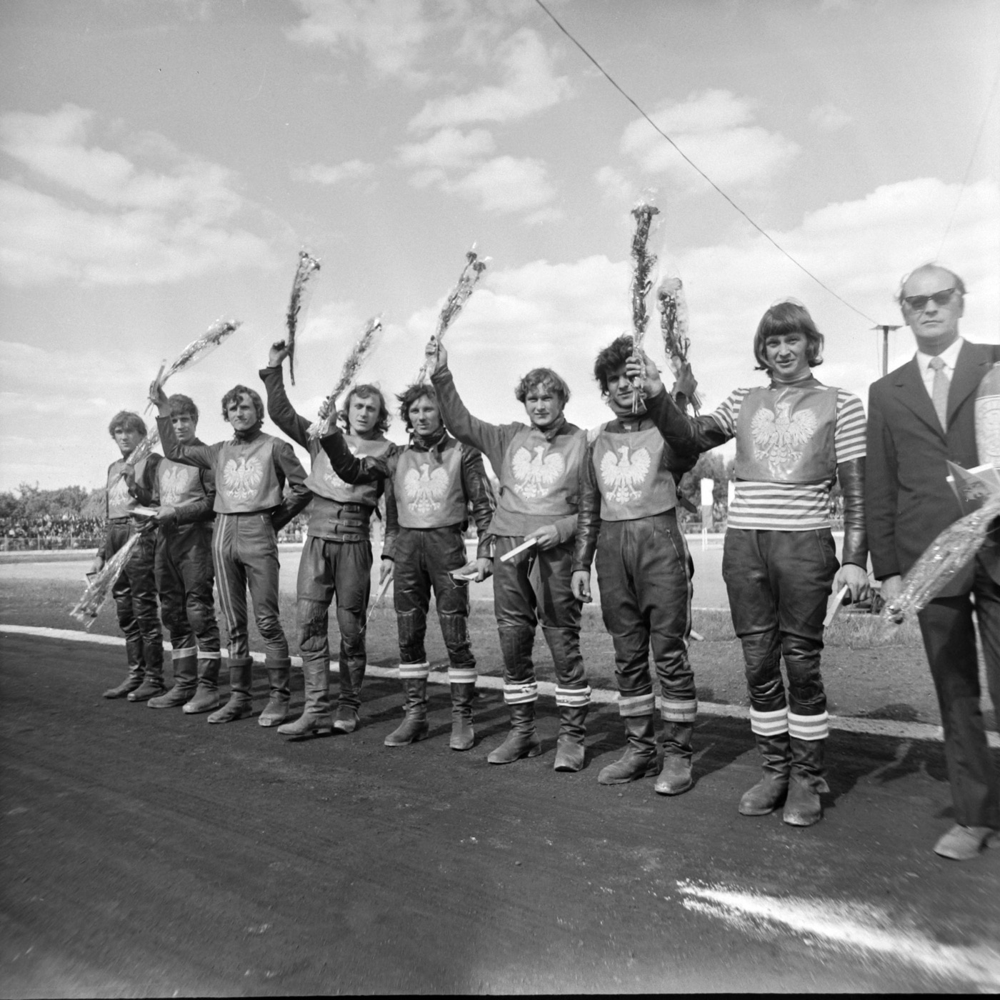
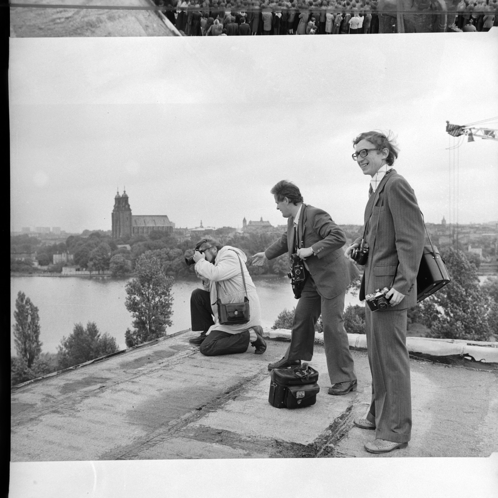
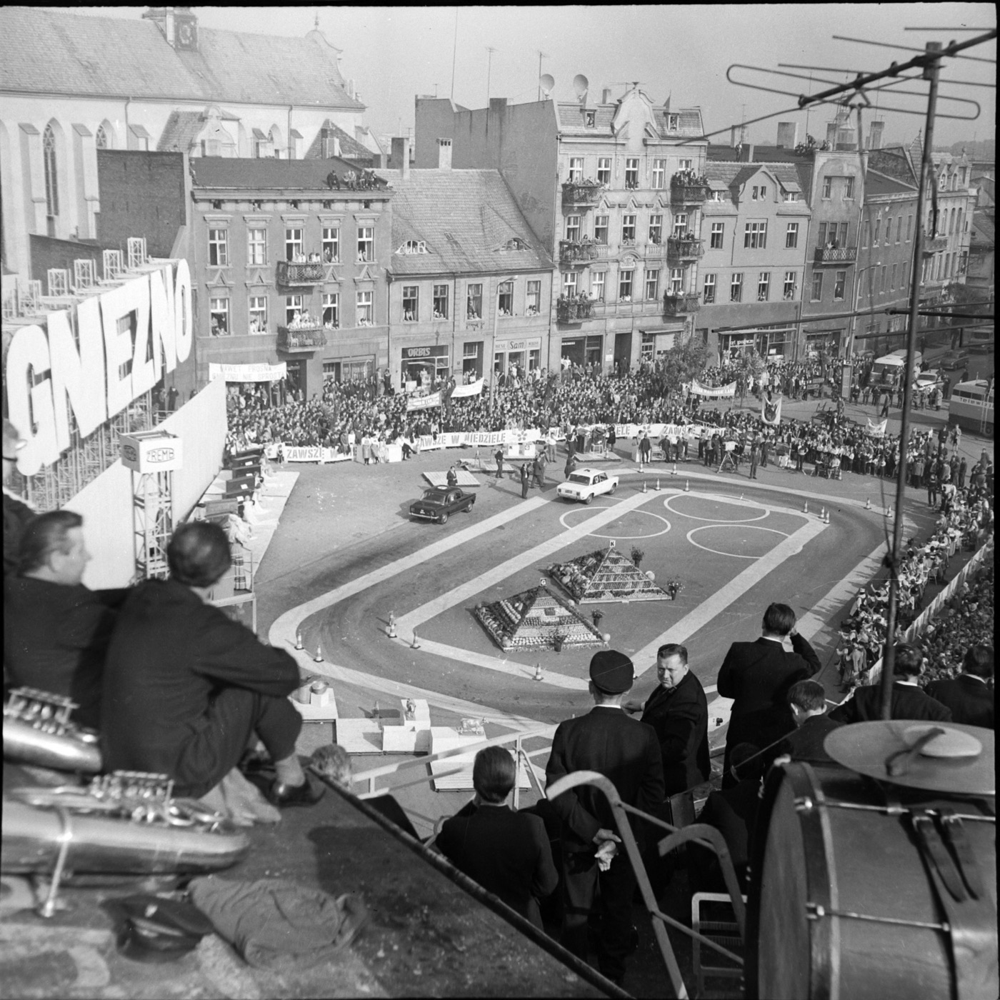
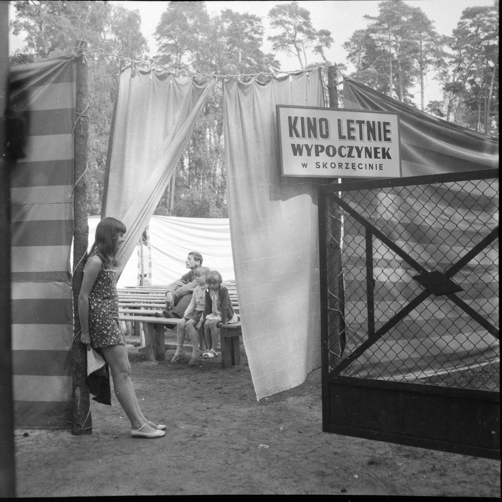
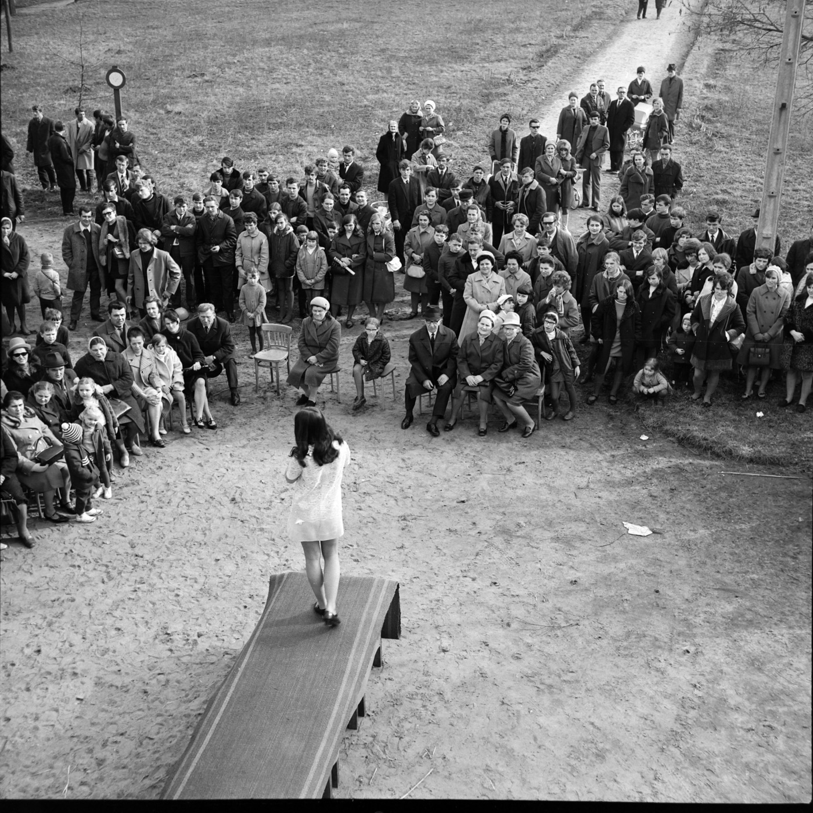

*Pochód pierwszomajowy na ulicach Gniezna, 1967. Fot. Janusz Chlasta.*

**Janusz Chlasta** (1938–2013) przez trzy dekady fotografował Gniezno i okolice: pochody pierwszomajowe, mecze żużlowe, nowe osiedla, sklepy, fabryki i zwykłych ludzi na ulicy. Po jego śmierci w zagraconym garażu zostało około 7 tysięcy filmów. Dziś to blisko 70 tysięcy zeskanowanych klatek, a negatywy trafiły do Archiwum Państwowego.

Na okładce jest jego zdjęcie z 1967 roku: pochód pierwszomajowy, chłopcy przebrani za kosmonautów i wielka rakieta na wózku. Kamila Snopek, autorka tekstu o Chlaście w Fotopolis, wymienia kadry z pompatycznych obchodów 1 Maja wśród swoich ulubionych, bo widać w nich empatię i poczucie humoru fotografa.

## Archiwum z garażu

Chlasta trzymał negatywy w garażu. Były tam filmy małoobrazkowe i średnioformatowe, czarno-białe i kolorowe ORWO. Wiele z nich było zniszczonych, poskręcanych i bez żadnych opisów.

Władysław Nielipiński, ważna postać gnieźnieńskiej fotografii i autor książki „Gorzko!”, znał Chlastę i jeszcze za jego życia pytał o negatywy. Usłyszał wtedy, że wszystko leży w zabałaganionym garażu. Po śmierci fotografa zbiór przechował syn, Grzegorz Chlasta, i to on poprosił Nielipińskiego, żeby go przejrzał. Od 2020 roku negatywy były czyszczone, porządkowane i skanowane. Wyszło z tego około 70 tysięcy plików, choć według Nielipińskiego to wciąż nie cały dorobek.

Najtrudniejsze były opisy. Na negatywach nie było informacji, kto i co jest na zdjęciu ani kiedy je zrobiono. Nielipiński szukał więc tych samych kadrów w gazetach, w których Chlasta publikował, i na tej podstawie datował kolejne filmy.

## Z Wilna przez kolej do redakcji

Chlasta urodził się w 1938 roku w Wilnie, w rodzinie kolejarskiej. W 1945 roku rodzina trafiła do Kalisza. On też poszedł na kolej: skończył szkołę zawodową, a potem Technikum Kolejowe w Bydgoszczy. Fotografią pasjonował się od dziecka. Pierwsze zdjęcie opublikował w „Głosie Wielkopolskim” jeszcze w siódmej klasie, a od 1956 roku współpracował z tą gazetą na stałe.

W 1959 roku kolej przeniosła go do Gniezna, na stanowisko dyspozytora lokomotywowni. Zaczął współpracować z „Gazetą Chłopską”, „Gazetą Poznańską” i Centralną Agencją Fotograficzną. Najważniejsze okazały się „Przemiany Ziemi Gnieźnieńskiej”, miesięcznik założony w 1965 roku. Chlasta był ich fotoreporterem do 1989 roku. W latach 1972–1979 robił też zdjęcia dla „Głosu Załogi”, gazety gnieźnieńskich zakładów pracy.

Przełom przyszedł w 1970 roku. Chlasta zdjął kolejarski mundur i został fotoreporterem na pełen etat.

*Mecz żużlowy Polska–Anglia w Gnieźnie, 1973. Fot. Janusz Chlasta.*

## Co fotografował

Większość ważnych wydarzeń w regionie. Pochody pierwszomajowe, wybory, zebrania i partyjne narady. Obchody Tysiąclecia Państwa Polskiego, budowę kościołów i osiedli, ustawianie pomnika Bolesława Chrobrego przed katedrą. Wizyty Edwarda Gierka i premiera Piotra Jaroszewicza, a także delegację z ZSRR z marszałkiem Wasilijem Czujkowem, który w 1945 roku przyjął kapitulację Berlina.

Obok wielkich wydarzeń jest zwykłe życie. Ludzie rozmawiają, handlują, stoją w kolejkach, piją piwo po pracy, wychowują dzieci. Chlasta chodził do fabryk, na wydział weterynaryjny, na imprezy i mecze. Żużel oglądał i fotografował co niedzielę. Sam mieszkał na osiedlu Winiary i fotografował też, jak takie osiedla powstają i się zaludniają.

Jeździł po całej Wielkopolsce: najpierw motocyklem albo przedwojenną Skodą, później małym Fiatem. W archiwum są wsie, praca w polu i letnicy w Powidzu i Skorzęcinie. Syn wspomina, że dla dobrego ujęcia ojciec potrafił wspiąć się na słup elektryczny albo zatrzymać autobus z ludźmi jadącymi do pracy, żeby zrobić zdjęcie z jego dachu.

*Grupa fotoreporterów przy pracy, Gniezno, 1978. Fot. Janusz Chlasta.*

*Telewizyjny Turniej Miast Gniezno–Kalisz, 1970. Fot. Janusz Chlasta.*

## Ciemnia, reklama i domowe foldery

Chlasta sam wywoływał filmy i robił powiększenia w redakcyjnej ciemni. Prenumerował zagraniczne magazyny fotograficzne i śledził, co dzieje się w fotografii na świecie. Aparatu nie odkładał też na wakacjach ani na rodzinnych spacerach.

Fotografował nie tylko do gazet. Robił portrety, czasem akty, zdjęcia z rodzinnych uroczystości znajomych. Dla Wielkopolskich Zakładów Obuwia „Polania” fotografował buty, a do zdjęć pozowały często pracownice fabryki. Odbitki zbijał potem ręcznie na podłodze w mieszkaniu w coś w rodzaju folderów. Próbował też kręcić kamerą filmową.

Snopek łączy jego zdjęcia z fotografią humanistyczną: w centrum zawsze jest człowiek, a w kadrach widać swojskość i lokalność, przez które te zdjęcia są po prostu „nasze”.

*Kino plenerowe w Skorzęcinie, 1969. Fot. Janusz Chlasta.*

## Fotoreporter w PRL

Chlasta pracował w PRL, czyli w świecie tematów narzucanych przez władzę i cenzury. Był dumny z rozwoju miasta i kraju i chętnie go dokumentował. W 1970 roku pokazał zdjęcia na wystawie z okazji 25-lecia PRL w Poznaniu. Jak pisze Snopek, w świecie narzuconych tematów utorował sobie zarazem własną, równoległą ścieżkę.

Pozostał wierny fotografii analogowej. Gdy po 1989 roku zmieniła się praca redakcji, a cyfrowe aparaty zaczęły wypierać film, odłożył aparat na półkę. Później sięgał po niego rzadko, a negatywy czekały w garażu.

„Dopiero jak odszedł, to doszliśmy do wniosku – Władek Nielipiński i ja – że tata był jednak artystą” – mówi Grzegorz Chlasta w rozmowie z Fotopolis.

*Pokaz mody podczas imprezy „Niedziela na wsi” w Powidzu, 1971. Fot. Janusz Chlasta.*

## Wystawy „Z garażu Janusza Chlasty” i album

Od maja do grudnia 2023 roku zdjęcia Chlasty pokazywał cykl wystaw „Z garażu Janusza Chlasty”. Odbyły się w Gnieźnie, Poznaniu, Powidzu, Kłecku, Środzie Wielkopolskiej, Szreniawie, Wągrowcu, Wrześni, Łubowie i Kowanówku.

Cykl zamknął album „Chlasta. Przemiany 1960–1989” wydany przez Miejski Ośrodek Kultury w Gnieźnie: 240 stron czarno-białych zdjęć w twardej oprawie. Koncepcję książki przygotował fotograf dokumentalista Mariusz Forecki, a teksty napisali m.in. historyk fotografii prof. Maciej Szymanowicz i Grzegorz Chlasta. W 2026 roku album doczekał się wznowienia.

Wtedy też rodzina przekazała negatywy do Archiwum Państwowego w Poznaniu. Przechowuje je oddział w Gnieźnie. To w jego czytelni Kamila Snopek przeglądała dysk ze zdigitalizowanymi zdjęciami.

## Galeria zdjęć Janusza Chlasty

Kliknij zdjęcie, żeby je powiększyć.

<!-- galeria -->

## Opisuj swoje negatywy

Historia Chlasty to też przestroga. Zdjęcie, które dziś wydaje się zwykłe, za kilkadziesiąt lat może być jedynym śladem ulicy, sklepu czy święta. A archiwum bez opisów trzeba potem latami odtwarzać z gazet. Warto więc opisywać negatywy i pliki: datę, miejsce i ludzi na zdjęciu. Oryginały przechowuj w odpowiednich warunkach i rób kopie zapasowe skanów.

O tym, jak zdjęcia przechowują pamięć, pisaliśmy też przy [konkursie Pamięć „W” kadrze 2026](/blog/pamiec-w-kadrze-2026-wyniki-konkursu.html) i we wpisie o [200 latach fotografii](/blog/200-lat-fotografii.html). Zdjęcia z filmu znajdziesz też na stronie [Analog](/analog.html).

## Źródła

- [Fotopolis, Kamila Snopek: Janusz Chlasta – trzy dekady historii Gniezna uratowane z zagraconego garażu](https://www.fotopolis.pl/inspiracje/znani-fotografowie/40008-janusz-chlasta-trzy-dekady-historii-gniezna-uratowane-z-zagraconego-garazu)
- [Rzeczpospolita, Jacek Cieślak: PRL w obiektywie Janusza Chlasty](https://www.rp.pl/fotografia/art40102041-prl-w-obiektywie-janusza-chlasty-gniezno-gierek-i-czujkow-ktory-zdobyl-berlin)
- [Archiwum Państwowe w Poznaniu](https://poznan.ap.gov.pl/)

Fotografie Janusza Chlasty pochodzą z materiałów Fotopolis.pl i należą do ich właścicieli.
