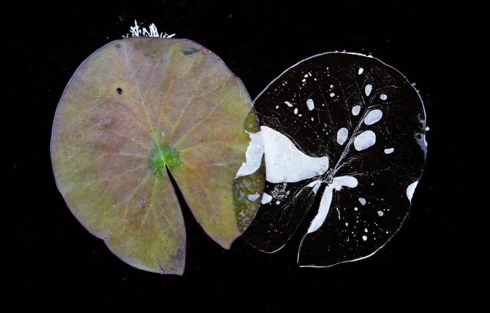
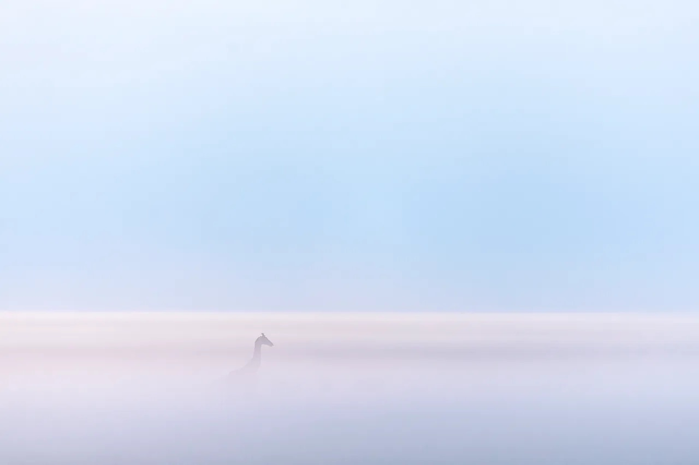
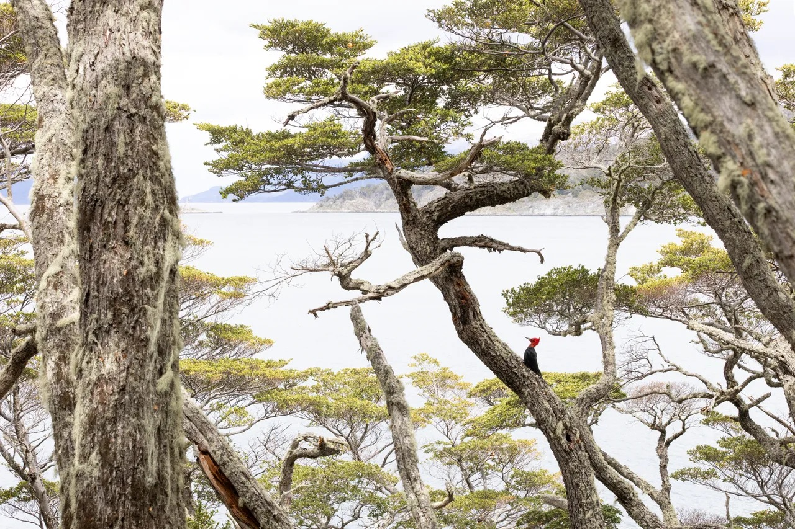
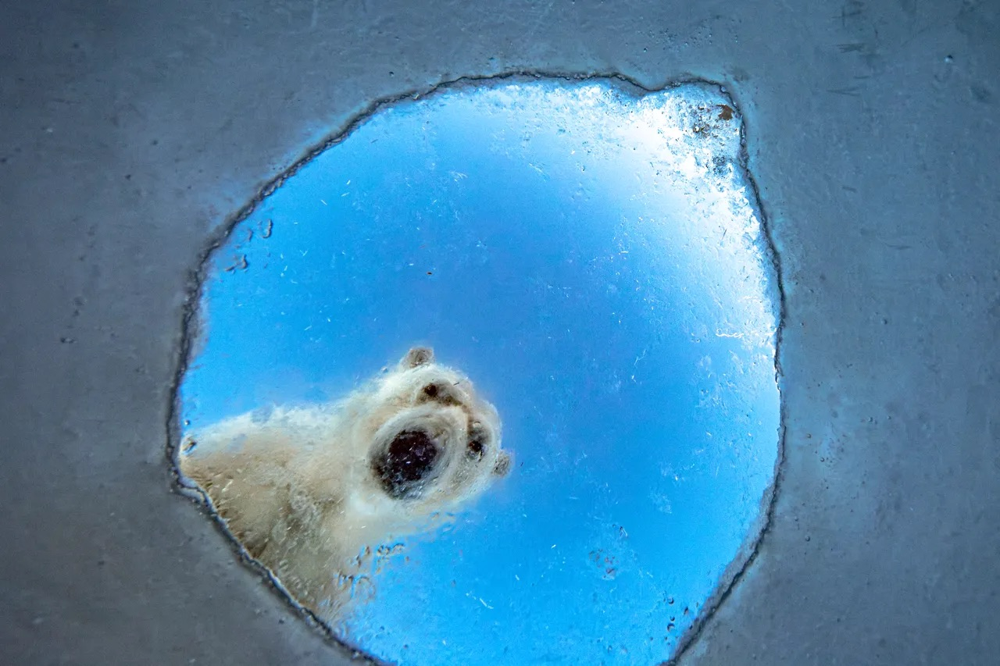
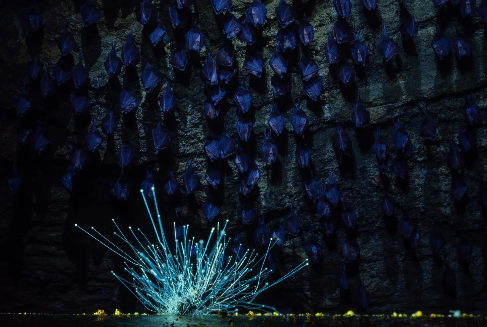
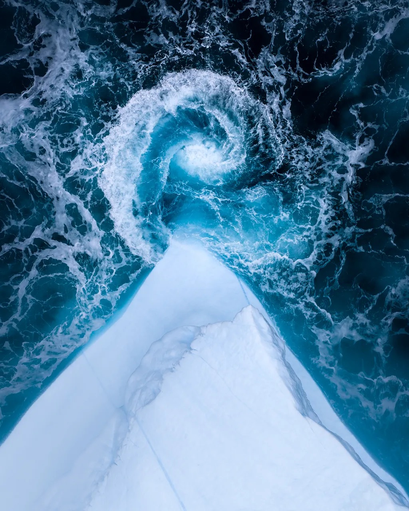
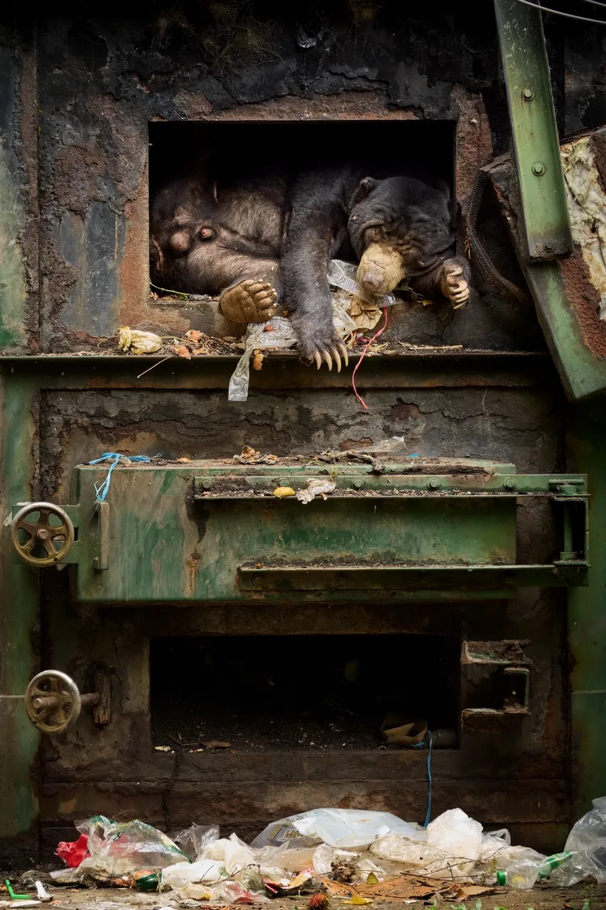

*„Hidden Away”, fot. Anna Terlecka. 2. miejsce w kategorii Mammals, Nature Photographer of the Year 2026.*

Sarna wychyla głowę z łanu złotych traw poprzetykanych chabrami. Za to zdjęcie **Anna Terlecka** zajęła 2. miejsce w kategorii Mammals (ssaki) w konkursie **Nature Photographer of the Year 2026**. To 11. edycja konkursu organizowanego przez holenderski festiwal Nature Talks. Tytuł fotografa roku i 3000 euro przypadły Hannu Ahonen z Finlandii za zdjęcie liścia lilii wodnej i jego szronowego odcisku na lodzie.

Niżej znajdziesz oba zdjęcia z opisem, kilka innych zwycięskich kadrów i tabelę zwycięzców wszystkich kategorii, a na końcu galerię z pozostałymi nagrodzonymi zdjęciami.

## Kto wygrał Nature Photographer of the Year 2026?

*„The one that left and the one that stayed”, fot. Hannu Ahonen. Zwycięzca Nature Photographer of the Year 2026 i 1. miejsce w kategorii Plants and fungi.*

Zwyciężyło zdjęcie **Hannu Ahonen** „The one that left and the one that stayed” („Ten, który odszedł, i ten, który został”). Wygrało też kategorię Plants and fungi (rośliny i grzyby). Na ciemnym lodzie leżą obok siebie dwa liście lilii wodnej. Jeden jest prawdziwy, a z drugiego został tylko biały, szronowy kontur.

Według opisu cytowanego przez Fotopolis pierwsze mrozy skuły staw lodem i część liści zaczęła się kruszyć. Wiatr porwał niektóre z nich, a pod spodem zostały wzory ze szronu w ich kształcie. Z opisu wynika też, że takiego zjawiska nie było wcześniej okazji zobaczyć.

To nie pierwszy nagrodzony liść w lodzie w dorobku Hannu Ahonen. W fińskim konkursie na przyrodnicze zdjęcie roku 2021, który prowadzi Fińskie Stowarzyszenie Fotografów Przyrody, kadr z liściem zatopionym w lodzie, „My heart is light like a butterfly”, wygrał kategorię Free and Creative.

## Anna Terlecka i sarna w złotym morzu traw

Zdjęcie „Hidden Away” (to, które widzisz na górze wpisu) zrobiła na mazurskiej łące. W opisie przytoczonym przez Fotopolis Anna Terlecka wspomina, że trawy na wietrze falowały „niczym złote morze, poprzetykane gdzieniegdzie błękitem chabrów”. Długo obserwowała łąkę, aż z głębi łanu wyłoniła się sarna. Zwierzę uniosło głowę i spojrzało w niebo. Wtedy zrobiła zdjęcie, a po chwili sarna znów zniknęła w trawie.

Prace Anny Terleckiej można oglądać na jej Instagramie [@wadera_wildlife](https://www.instagram.com/wadera_wildlife/).

Kategorię Mammals wygrał Paul Goldstein mgłą, z której wystaje tylko szyja żyrafy:

*„Play misty”, fot. Paul Goldstein. 1. miejsce w kategorii Mammals.*

## Wybrane zwycięskie zdjęcia

W kategorii Birds (ptaki) wygrał „Painting from the end of the world” („Obraz z końca świata”). Mały dzięcioł z czerwoną głową ginie wśród powykręcanych, porośniętych porostami drzew.

*„Painting from the end of the world”, fot. Lucas Mugnier-Lavorel. 1. miejsce w kategorii Birds.*

Audun Rikardsen sfotografował niedźwiedzia polarnego od strony wody, przez przerębel. Tytuł „A seal's worst nightmare” („Najgorszy koszmar foki”) mówi, kto zwykle ogląda ten widok.

*„A seal's worst nightmare”, fot. Audun Rikardsen. 1. miejsce w kategorii Animal portraits.*

W kategorii Plants and fungi drugie miejsce zajęło zdjęcie z jaskini. Pod nietoperzami wiszącymi na skale wyrasta z guana pęk jasnych, niebieskawych nitek.

*„Guano Blooming”, fot. Imre Potyó. 2. miejsce w kategorii Plants and fungi.*

*„Spiral”, fot. Jeroen Van Nieuwenhove. 2. miejsce w kategorii Landscapes.*

W kategorii Humans and nature (człowiek i przyroda) wygrało zdjęcie, które trudno nazwać pięknym. Niedźwiedź leży w otworze zardzewiałej metalowej konstrukcji, a pod nim walają się śmieci. Tytuł brzmi „Evolution”.

*„Evolution”, fot. Petr Bambousek. 1. miejsce w kategorii Humans and nature.*

## Zwycięzcy wszystkich kategorii

Lista według oficjalnej strony z wynikami.

| Kategoria | 1. miejsce | 2. miejsce |
|---|---|---|
| Birds | Lucas Mugnier-Lavorel, „Painting from the end of the world” | Andy Parkinson, „Boatstrike” |
| Mammals | Paul Goldstein, „Play misty” | **Anna Terlecka, „Hidden Away”** |
| Other animals | Marcus Kuan, „The Pitcher's Micro-Kingdom” | Suliman Alatiqi, „Exploring the Terrain” |
| Plants and fungi | Hannu Ahonen, „The one that left and the one that stayed” | Imre Potyó, „Guano Blooming” |
| Landscapes | J Fritz Rumpf, „In The Circle of Vultures Around the Falls” | Jeroen Van Nieuwenhove, „Spiral” |
| Underwater | Matt Pérez, „Beneath Aquatic Constellations” | David Antoja, „Living Sun” |
| Natural art | Xuzhong Liu, „Peach Blossoms in the Snow” | Jurrie Renskers, „Tropical bird” |
| Humans and nature | Petr Bambousek, „Evolution” | Lukas Schaefer, „Helping Hands” |
| Black and white | László Tóth, „Storm on the sea” | Sage Ono, „Canopy Crawler” |
| Animal portraits | Audun Rikardsen, „A seal's worst nightmare” | Pierre Watson, „Gliding” |
| Nature of De Lage Landen | Enikő Kálovics, „Fairies” | Edwig Vanhassel, „Eurasian eagle owl in early spring” |
| Youth | Parham Pourahmad, „Tree of Life” | Flynn Thaitanunde-Lobb, „Buzzing Past” |
| Portfolio | Simone Baumeister, „Eagle owls in the city: The invisible visible” | – |

Nagrodę przyznała też publiczność. Według Fotopolis wygrało zdjęcie „Runners” Andrésa Basilio Sagarny, a drugie było „Bad place” Toma Haugaarda Svenssona. Oba są w galerii poniżej.

## Galeria zwycięzców Nature Photographer of the Year 2026

Kliknij zdjęcie, żeby je powiększyć. Strzałkami przejdziesz do kolejnych.

<!-- galeria -->

## Jak działa konkurs

Nature Photographer of the Year organizuje Nature Talks, festiwal fotografii przyrodniczej w Holandii. Zwycięzców ogłoszono 14 listopada 2026 roku na festiwalu, gdzie można też zobaczyć wystawę nagrodzonych zdjęć. Potem wystawa ruszy w trasę po Holandii, Belgii i Francji.

- **Kategorie:** 13, w tym portfolio i kategoria dla młodzieży. Osobna kategoria, Nature of De Lage Landen, jest poświęcona przyrodzie Niderlandów („de Lage Landen”).
- **Nagrody:** łącznie 25 000 euro. Zwycięzca całego konkursu dostaje 3000 euro, za wygraną w większości kategorii jest 500 euro, a za portfolio 1000 euro.
- **Jury:** przewodniczący Theo Bosboom oraz Lana Tannir, Steffen Foerster, Louis Guillot i Ilse Koks.
- **Skala:** organizator nie podał jeszcze liczby zgłoszeń z 2026 roku. Rok wcześniej nadesłano 24 781 zdjęć z 96 krajów.

Organizatorzy założyli też fundację Stichting Nature Talks, która wspiera organizacje chroniące przyrodę, m.in. Photographers Against Wildlife Crime.

Zgłoszenia do edycji 2026 przyjmowano od 7 kwietnia do 8 czerwca. Terminu edycji 2027 organizator jeszcze nie ogłosił. Warto zaglądać na stronę konkursu, jeśli masz w archiwum dobre zdjęcia przyrody.

Jeśli lubisz takie zestawienia, zajrzyj też do wpisów o [Wildlife Photographer of the Year 2026](/blog/wildlife-photographer-of-the-year-2026-federico-veronesi.html), [Bird Photographer of the Year 2026](/blog/bird-photographer-of-the-year-2026.html) i [Weather Photographer of the Year 2026](/blog/weather-photographer-of-the-year-2026-finalisci.html).

## Źródła

- [Fotopolis.pl: Anna Terlecka wśród zwycięzców Nature Photographer of the Year 2026](https://www.fotopolis.pl/inspiracje/galerie/40016-anna-terlecka-wsrod-zwyciezcow-nature-photographer-of-the-year-2026-zobaczcie-najlepsze-zdjecia-natury) (Maciej Luśtyk)
- [Nature Photographer of the Year: wyniki 2026](https://naturephotographeroftheyear.com/npoty-2026-results/)
- [Nature Photographer of the Year: regulamin i nagrody edycji 2026](https://naturephotographeroftheyear.com/enter-contest/npoty-2026/)
- [Nature Photographer of the Year: jury 2026](https://naturephotographeroftheyear.com/enter-contest/jury-npoty/)
- [This is Finland: Finnish wildlife photographers continue to garner international recognition](https://finland.fi/arts-culture/finnish-wildlife-photographers-continue-to-garner-international-recognition/)

Fotografie pochodzą z materiałów Fotopolis.pl i należą do ich autorów oraz organizatorów konkursu Nature Photographer of the Year.
