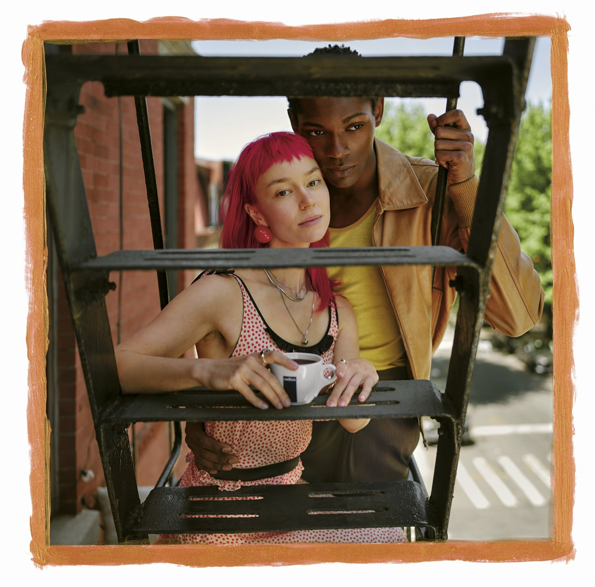
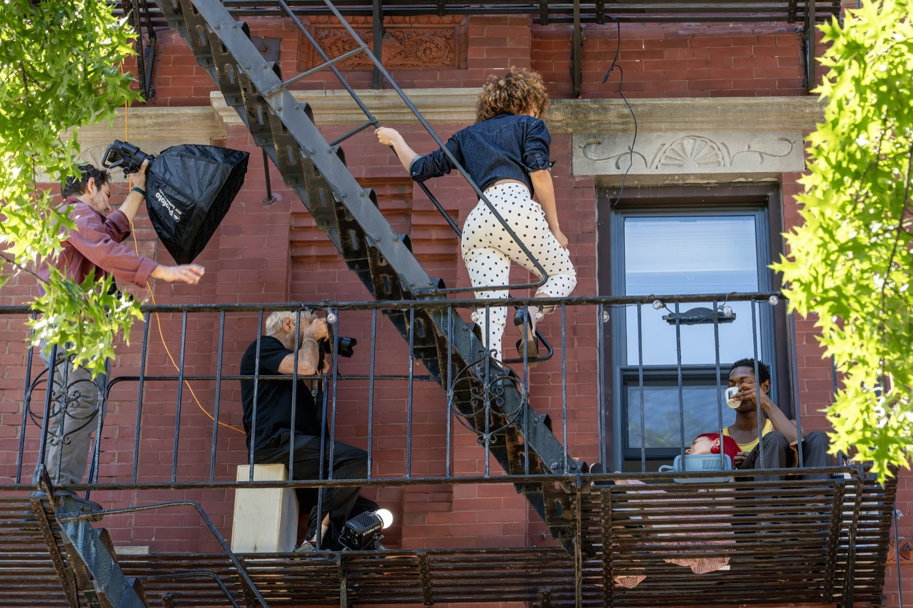
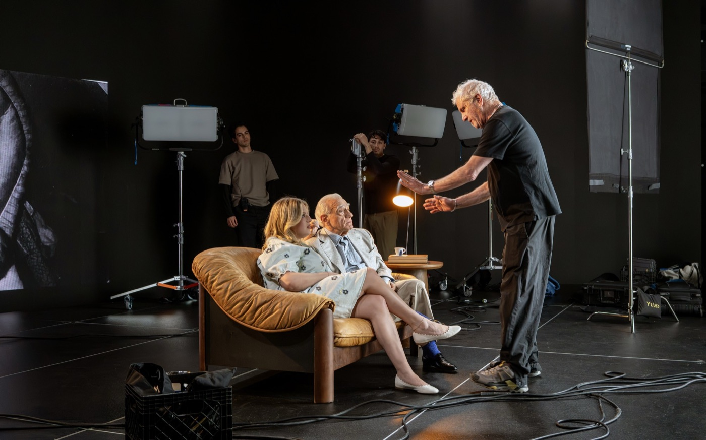
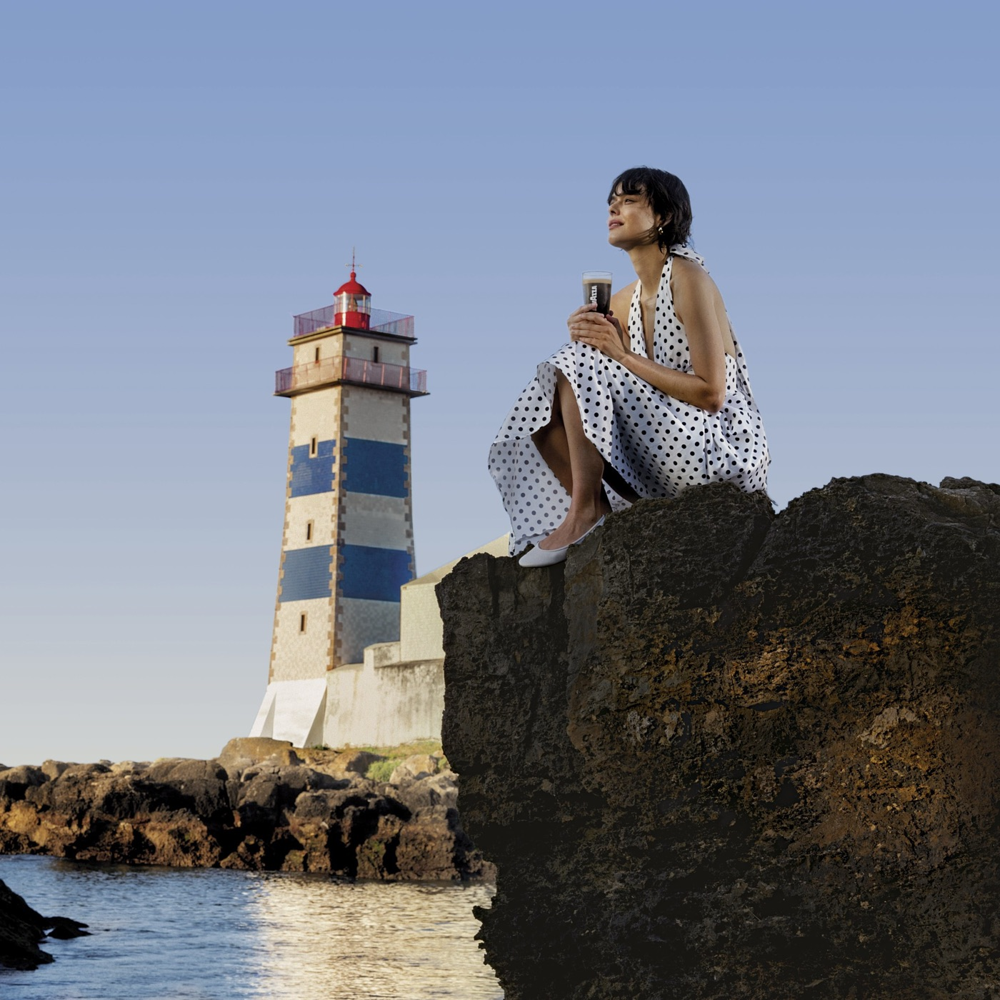
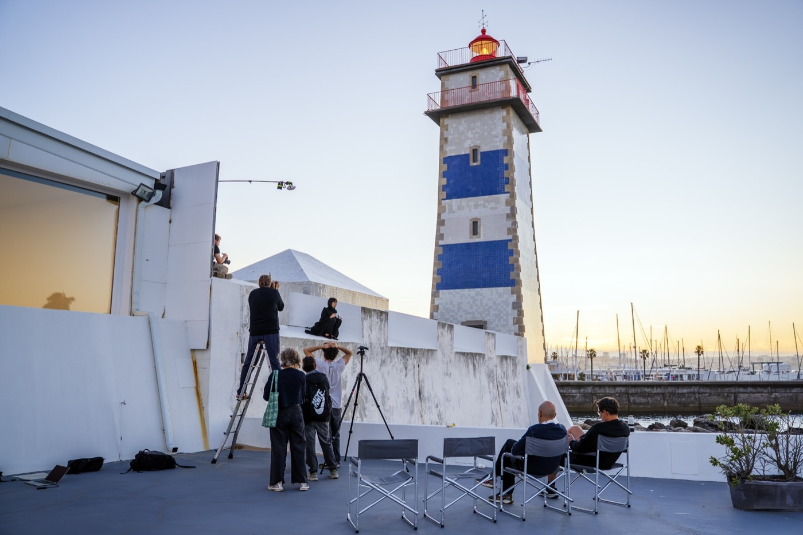
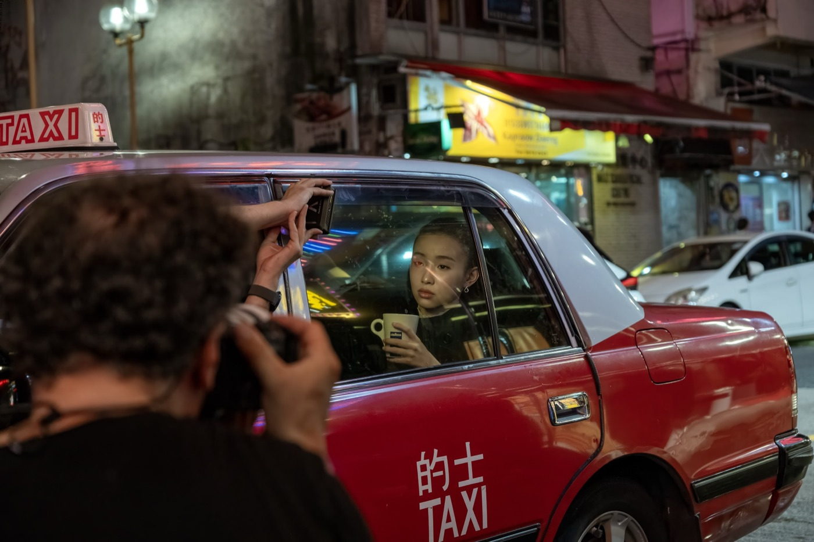

*Okładka części z Hongkongu, fot. Paolo Pellegrin / Kalendarz Lavazza 2027.*

**Kalendarz Lavazza 2027** nosi tytuł „Always a Pleasure”. To 35. edycja kalendarza włoskiej marki kawy, a autorów jest tym razem trzech, wszyscy z agencji **Magnum Photos**: Jim Goldberg fotografował Nowy Jork, Alex Majoli Lizbonę, a Paolo Pellegrin Hongkong. Każdy przygotował okładkę i cztery miesiące, więc w kalendarzu jest 15 zdjęć. Kawa pojawia się w kadrach, ale nie gra w nich głównej roli.

## „Always a Pleasure”: o czym jest kalendarz

Lavazza prowadzi kampanię „Pleasure makes us human” („Przyjemność czyni nas ludźmi”). Kalendarz 2027 skupia się na przyjemności zamkniętej w krótkiej chwili. Zdjęcia prowadzą od porannego światła do wieczoru i pokazują kawę jako codzienny rytuał, który wygląda inaczej w każdym mieście. Kierunek kreatywny, jak w poprzednich latach, wyznaczyła agencja Armando Testa.

Francesca Lavazza z zarządu Grupy Lavazza mówi, że kalendarz od ponad 30 lat jest miejscem, gdzie tożsamość marki spotyka się z niezależnym spojrzeniem artystów. Według niej trzech fotografów łączy umiejętność łapania tego, „co dzieje się między ludźmi”.

To nie pierwsza współpraca Lavazzy z Magnum. Wcześniejsze kalendarze robili m.in. Elliott Erwitt, Steve McCurry i Ferdinando Scianna, a wersję na 2026 rok Alex Webb, który fotografował Włochy. Sama agencja Magnum, założona w 1947 roku przez Henriego Cartier-Bressona, Roberta Capę, George'a Rodgera i Davida Seymoura, w 2027 roku skończy 80 lat.

## Nowy Jork według Jima Goldberga (styczeń–kwiecień)

*Okładka części z Nowego Jorku, fot. Jim Goldberg / Kalendarz Lavazza 2027.*

Kalendarz otwiera Nowy Jork. Goldberg domalował na odbitkach ramki i dopisał ręcznie zdania, jak w swoich dawnych projektach, w których łączył zdjęcia z tekstem. Mówi o sobie, że jest w Nowym Jorku „turystą”. Okładkę i luty zrobił na schodach przeciwpożarowych kamienicy, które znamy z amerykańskich filmów.

Styczeń jest żartobliwy: dziewczyna pije kawę zanurzona po szyję w pianie. Marzec to opiekun psów na schodach kamienicy, otoczony podopiecznymi podpisanymi imionami. W kwietniu na zdjęciu są Martin Scorsese i jego córka Francesca, też reżyserka. Oboje występują w serialu reklamowym Lavazzy „Family Blend”.

*Za kulisami w Nowym Jorku: sesja na schodach przeciwpożarowych.*

*Za kulisami w Nowym Jorku: sesja zdjęcia na kwiecień z Martinem i Francescą Scorsese.*

Jim Goldberg urodził się w 1953 roku w Connecticut. Od lat fotografuje ludzi z marginesu, w długich projektach opartych na współpracy z bohaterami. Najbardziej znane to „Rich and Poor” (1977–1985), „Raised by Wolves” (1985–1995) i „Open See” (2003–2011). Dostał m.in. nagrodę Henri Cartier-Bresson (2007) i Deutsche Börse Photography Prize (2011). Jest profesorem emerytowanym California College of the Arts. Przyjemność łączy z pracą: według niego bierze się z tworzenia czegoś, czym można podzielić się z innymi.

## Lizbona według Alexa Majoliego (maj–sierpień)

*Okładka części z Lizbony, fot. Alex Majoli / Kalendarz Lavazza 2027.*

Majoli od lat prowadzi projekt „Scene”: sztucznym światłem dramatyzuje zwykłe sytuacje, tak że ulica wygląda jak plan filmowy. Także w jego lizbońskich zdjęciach codzienne sceny nabierają teatralnego charakteru. W maju poranne światło pada na ocean, w czerwcu dwóch kolegów pije kawę przy żółtym tramwaju, w lipcu para tańczy przed ścianą z azulejos, a sierpień to śpiewaczka fado z gitarzystami. Sam Majoli opisuje przyjemność jako „intensywność bycia tu i teraz”, kiedy na chwilę widać teatr codziennego życia.

*Za kulisami w Lizbonie: sesja okładki przy latarni morskiej.*

Alex Majoli urodził się w 1971 roku w Rawennie. Pełnym członkiem Magnum jest od 2001 roku. Jako fotoreporter fotografował m.in. upadek talibów w Afganistanie, a od dwudziestu lat pracuje nad projektem o Brazylii „Tudo Bom”.

## Hongkong według Paola Pellegrina (wrzesień–grudzień)

Pellegrin otwiera swoją część okładką z dziewczyną w taksówce, z kawą w ręku i neonami w szybie (to zdjęcie na górze wpisu). Dalej są dziewczyny przy mahjongu, dziadek z wnuczką na promie, artyści opery kantońskiej za kulisami i młoda kobieta w deszczu pod przezroczystym parasolem. Pellegrin mówi, że szuka chwili, w której „samo życie” wdziera się w kadr, a przyjemność to dla niego otwartość na to, czego nie da się zaplanować.

*Za kulisami w Hongkongu: sesja okładki w taksówce.*

Paolo Pellegrin urodził się w 1964 roku w Rzymie. Do Magnum dołączył w 2001 roku, a pełnym członkiem jest od 2005. Ma na koncie dziesięć nagród World Press Photo i Złoty Medal Roberta Capy. Znany jest ze zdjęć wojen i kryzysów humanitarnych, a w 2022 roku pokazał w Turynie duży projekt o zmianach klimatu. W kalendarzu Lavazzy fotografuje drobne przyjemności.

## Premiera w Muzeum Guggenheima

Kalendarz pokazano w listopadzie 2026 roku w Muzeum Guggenheima w Nowym Jorku. Lavazza wspiera to muzeum od 2014 roku. Od 2023 roku Guggenheim uczestniczy też w programie IncluVisity, w którym Lavazza finansuje dostępne zwiedzanie muzeów dla osób z różnymi potrzebami.

## Kalendarz Lavazza 2027 miesiąc po miesiącu

Wszystkie 12 miesięcy po kolei, a pod nimi zdjęcia z planu. Kliknij zdjęcie, żeby je powiększyć. Strzałkami przejdziesz do kolejnych.

<!-- galeria -->

## Źródła

- [Fotopolis.pl: Kalendarz Lavazza 2027 zaprezentowany! Autorów jest aż trzech](https://www.fotopolis.pl/inspiracje/galerie/40011-kalendarz-lavazza-2027-zaprezentowany-autorow-jest-az-trzech-jim-goldberg-alex-majoli-i-paolo-pellegrin) (Krzysztof Mularczyk)
- [Lavazza: Calendario Lavazza 2027](https://www.lavazza.it/it/calendario-2027)
- [Comunicaffè: Calendario Lavazza 2027, il rito del caffè in tre città](https://www.comunicaffe.it/calendario-lavazza-2027-always-a-pleasure/)
- [Zon.it: Calendario Lavazza 2027: Goldberg, Majoli e Pellegrin](https://zon.it/calendario-lavazza-2027-magnum-goldberg-majoli-pellegrin/)
- Magnum Photos: biogramy [Jima Goldberga](https://www.magnumphotos.com/photographer/jim-goldberg/), [Alexa Majoliego](https://www.magnumphotos.com/photographer/alex-majoli/) i [Paola Pellegrina](https://www.magnumphotos.com/photographer/paolo-pellegrin/)

Fotografie pochodzą z materiałów Fotopolis.pl i należą do ich autorów oraz Lavazzy.
