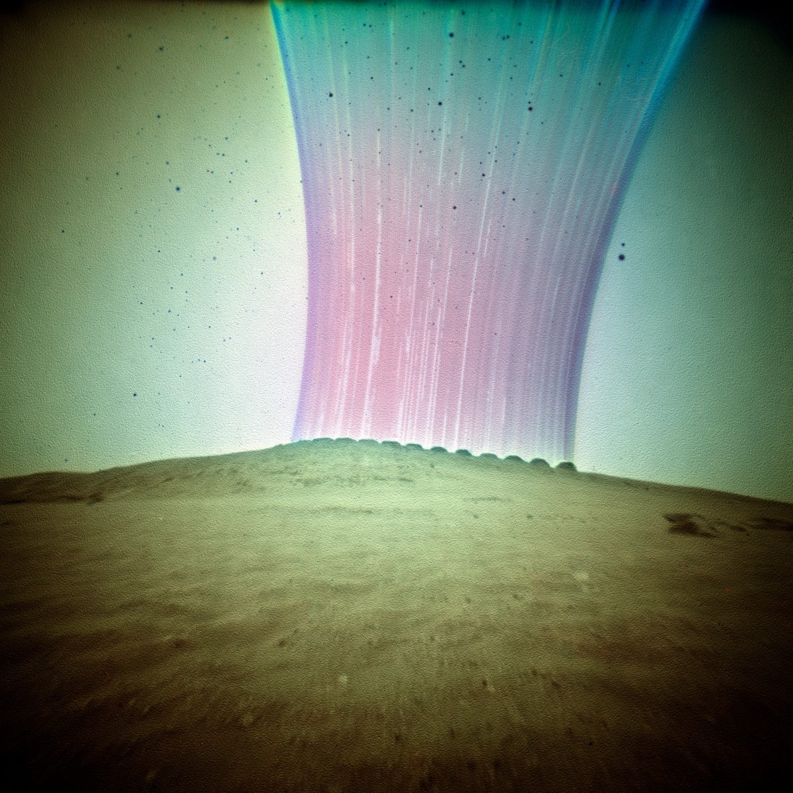
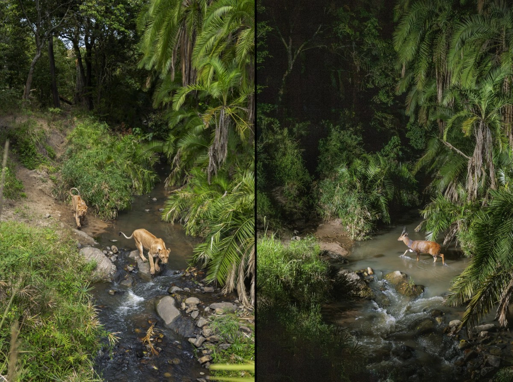
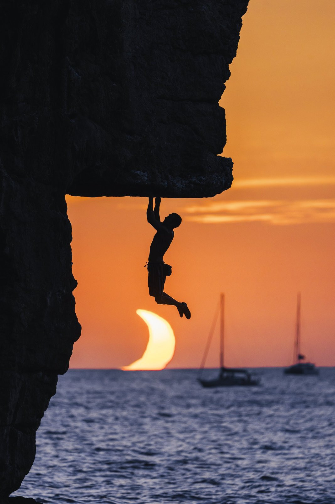
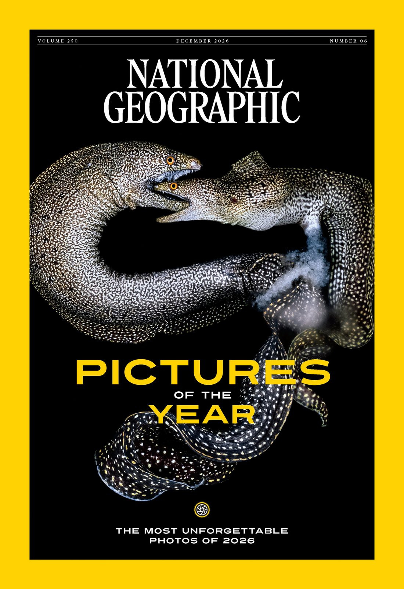

*„Monkey Business”, fot. Prakash Matada / National Geographic Pictures of the Year 2026.*

**National Geographic** opublikowało 17 listopada 2026 roku zestawienie **Pictures of the Year 2026**. To 25 zdjęć wybranych spośród ponad miliona kadrów, które fotografowie magazynu zrobili w ciągu ostatnich 12 miesięcy. Nie jest to konkurs: redakcja nie przyznaje miejsc ani nagród, tylko wybiera zdjęcia, które, jak pisze, „zostały z nami”. Cały zestaw ukaże się też w grudniowym numerze magazynu.

Są tu zdjęcia przyrody, ale też reportaże o klimacie, rolnictwie i tradycjach, sport i eksperymenty techniczne: fotopułapka, aparat otworkowy naświetlany przez pół roku, obiektyw rybie oko na teleskopowym wysięgniku.

## Prawdziwe zdjęcia w czasach AI

Redaktor naczelny National Geographic Nathan Lump zwraca uwagę, że tegoroczna selekcja powstaje w czasie, gdy coraz więcej jest obrazów generowanych przez sztuczną inteligencję. Według niego im trudniej odróżnić prawdziwe zdjęcie od syntetycznego, tym ważniejsze staje się dokumentowanie rzeczywistości.

## Słońce nad Chankillo: pół roku na jednym arkuszu

*„Catching Solar Rays”, fot. Diego López Calvín / National Geographic Pictures of the Year 2026.*

Jedno z najbardziej nietypowych zdjęć zestawienia zrobił hiszpański fotograf Diego López Calvín w Peru. Ustawił aparat otworkowy, czyli pudełko bez obiektywu z małym otworem, przy kompleksie Chankillo. To najstarsze znane obserwatorium słoneczne w obu Amerykach: 13 kamiennych wież zbudowanych na grzbiecie wzgórza ok. III wieku p.n.e. tworzy kalendarz, który wyznacza ruch Słońca w ciągu roku.

Aparat naświetlał papier światłoczuły przez sześć miesięcy, od czerwcowego do grudniowego przesilenia (według Fotopolis od 21 czerwca do 21 grudnia 2025 roku). Każda wąska smuga w łuku to droga Słońca w ciągu jednego dnia. López Calvín zeskanował papier i odwrócił obraz. Róże, błękity i fiolety to efekt reakcji soli srebra w papierze na promieniowanie ultrafioletowe. Takie zdjęcia autor nazywa solarigrafiami i robi je na całym świecie od 2000 roku.

## Fotopułapka w Masai Mara

*„Animal Crossing”, fot. Will Burrard-Lucas / National Geographic Pictures of the Year 2026.*

Will Burrard-Lucas razem ze strażnikami rezerwatu Masai Mara w Kenii ukrył fotopułapkę wysoko na brzegu rzeki. Chciał sfotografować krytycznie zagrożone nosorożce czarne. Te rzeczywiście przyszły, ale ukryta przeprawa okazała się ruchliwym szlakiem: przechodziły tędy słonie, lamparty, hipopotamy, guźce, żyrafy, a także lwy, które w Masai Mara zwykle chodzą po otwartej sawannie, a nie przez las. Na prawym kadrze widać rzadko spotykaną antylopę buszbok.

Według Fotopolis za tę serię Burrard-Lucas zdobył w kwietniu pierwsze miejsce w kategorii profesjonalnej Wildlife & Nature konkursu Sony World Photography Awards 2026.

## Zaćmienie nad Majorką

*„Total Cliff-Hanger”, fot. Chris Burkard / National Geographic Pictures of the Year 2026.*

To ujęcie było starannie zaplanowane. Wspinacz Chris Sharma, pionier wspinaczki nad wodą bez lin (deepwater soloing), wisi pod poziomym wapiennym nawisem na Majorce, tuż po sierpniowym całkowitym zaćmieniu Słońca. Chris Burkard i jego asystent Joel Barger fotografowali z plaży oddalonej o ok. 180 metrów, kiedy Księżyc zsuwał się z tarczy Słońca, a Słońce chowało się za horyzont. Burkard mówi, że faza całkowita była fascynująca, ale wspinaczka Sharmy to chyba najbardziej niezwykła rzecz, jaką kiedykolwiek zobaczy.

## Langury w obiektywie rybie oko

Zdjęcie na górze wpisu zrobił Prakash Matada w stanie Asam w Indiach. Na teleskopowym wysięgniku zamocował obiektyw rybie oko i podsunął go stadu langurów złocistych. To zagrożony gatunek małp żyjących w koronach drzew. Tutejsze stado przyzwyczaiło się do ludzi, a małpy zaglądały w obiektyw, oglądając własne odbicie w przedniej soczewce.

## Mureny i rekin polarny

*Okładka grudniowego numeru National Geographic z zestawieniem Pictures of the Year 2026 (materiały Fotopolis.pl).*

Grudniową okładkę zajmują mureny. Ich tarło pokazuje też pierwsze zdjęcie zestawienia, autorstwa Tony'ego Wu. Jest on pierwszym człowiekiem, który sfotografował w naturze tarło węgorzy (mureny to ryby węgorzokształtne). Od 2023 roku spędził ze swoim zespołem setki godzin pod wodą w okolicach Kagoshimy w Japonii, dokumentując rozród czterech gatunków. Odkryli, że całe tarło trwa niecałe dwie sekundy: ryby wypadają z kryjówek w koralowcach, uwalniają gamety i wracają. Dzieje się to nocą, więc Wu pracował przy słabym czerwonym świetle, które nie płoszy ryb. Za ten projekt zdobył też pierwsze miejsce w kategorii Underwater w [Wildlife Photographer of the Year 2026](/blog/wildlife-photographer-of-the-year-2026-federico-veronesi.html).

W zupełnie innych warunkach pracował Kiliii Yüyan. Sfotografował rekina polarnego w fiordzie Ammassalik przy Kulusuk na wschodzie Grenlandii. Rekiny polarne żyją nawet 500 lat i są najdłużej żyjącymi kręgowcami na Ziemi. Yüyan uważa, że sfotografowany osobnik to młodzik, który urodził się mniej więcej w czasie wojny secesyjnej. Według Fotopolis zdjęcie powstało w marcu 2026 roku pod metrową warstwą lodu, w wodzie o temperaturze ok. -2°C. Chwilę po zrobieniu zdjęcia zespół na lodzie pociągnął za linę, wzywając nurków na górę: w pobliżu pojawił się niedźwiedź polarny, który poluje na foki przy przeręblach.

## Wszystkie 25 Zdjęć Roku 2026

Pełna lista w kolejności z galerii National Geographic. Jason Gulley ma w zestawieniu dwa zdjęcia, więc autorów jest 24.

| # | Tytuł | Fotograf | Miejsce | Co na zdjęciu |
|---|---|---|---|---|
| 1 | Caught in the Act | Tony Wu | Kagoshima, Japonia | Tarło muren, pierwszy raz sfotografowane w naturze |
| 2 | Coming to Grips | Justin Jin | Dolina Darchad, Mongolia | Zapaśnicy podczas festiwalu Naadam |
| 3 | Open Wide | Ralph Pace | Zatoka South Taranaki, Nowa Zelandia | Wieloryb z otwartym pyskiem żeruje na krylu |
| 4 | Busy Bees | Anand Varma | Berkeley, Kalifornia, USA | Trzmiele w akrylowym gnieździe badawczym |
| 5 | Encroaching Sands | John Stanmeyer | Tulo-Tulo, Nigeria | Wydmy zasypują dom, pustynnienie Sahelu |
| 6 | Unbridled Joy | Jasper Doest | Trydent, Włochy | Kobieta podaje koniowi kapelusz na farmie w Alpach |
| 7 | A Flourish in Flight | Jaime Rojo | Chiapas, Meksyk | Kwezal herbowy w locie, po 10 dniach w czatowni |
| 8 | Catching Solar Rays | Diego López Calvín | Ancash, Peru | Solarigrafia nad obserwatorium Chankillo |
| 9 | Shooting for the Moon | Paolo Verzone | Kolonia, Niemcy | Astronauta Thomas Pesquet trenuje w symulatorze Księżyca |
| 10 | Monkey Business | Prakash Matada | Asam, Indie | Langury złociste zaglądają w obiektyw rybie oko |
| 11 | A Hard Day's Rest | Matthieu Paley | Korytarz Wachański, Afganistan | Pasterz jaków odpoczywa przy ogniu |
| 12 | Future of Farming | Brent Stirton | Uniontown, Waszyngton, USA | Dzieci na pryzmach kompostu na rodzinnej farmie |
| 13 | Guardians of Giants | Lalo de Almeida | Maraã, Amazonas, Brazylia | Rybacy i stukilogramowa arapaima |
| 14 | Beams of Hope | Christopher Payne | Nowy Jork, USA | Technicy przygotowują „Tribute in Light” |
| 15 | Realm of the Zombie Sharks | Kiliii Yüyan | Kulusuk, Grenlandia | Rekin polarny pod lodem |
| 16 | Foraging Ahead | Amy Toensing | Lindås, Norwegia | 79-latka zbiera kurki w lesie |
| 17 | A Real Softie | Marcus Westberg | Park Narodowy Gonarezhou, Zimbabwe | Ważenie ciężarnej samicy łuskowca uratowanej od kłusowników |
| 18 | Total Cliff-Hanger | Chris Burkard | Majorka, Hiszpania | Chris Sharma pod nawisem po zaćmieniu Słońca |
| 19 | The Night Shift | Jason Gulley | Wyspa Khon, Laos | Rybak śpi na jazie pod wodospadem na Mekongu |
| 20 | Pilgrims' Plight | Angela Ponce | Dolina Sinakara, Peru | Pielgrzymka Qoyllur Rit'i do lodowca |
| 21 | Pearls of the Pond | Shane Gross | Ontario, Kanada | Ropuchy i sznury jaj w jeziorze badawczym |
| 22 | Sun, Sand, and Salt Mines | George Steinmetz | Jezioro Qarhan, Qinghai, Chiny | Słone jezioro, kopalnia i turystyka |
| 23 | Animal Crossing | Will Burrard-Lucas | Masai Mara, Kenia | Zwierzęta na fotopułapce nad rzeką |
| 24 | Fiery Advance | Chantal Pinzi | El Jadida, Maroko | Tbourida, pokaz konnej szarży z wystrzałem |
| 25 | Survival of the Fishiest | Jason Gulley | Rzeka Suwannee, Floryda, USA | Jesiotry w wodzie oczyszczonej przez suszę |

Wszystkie zdjęcia z pełnymi opisami można obejrzeć na [stronie National Geographic](https://www.nationalgeographic.com/photography/graphics/pictures-of-the-year-2026).

Jeśli lubisz takie zestawienia, zajrzyj też do wpisów o [Wildlife Photographer of the Year 2026](/blog/wildlife-photographer-of-the-year-2026-federico-veronesi.html) i [Nature Photographer of the Year 2026](/blog/nature-photographer-of-the-year-2026-anna-terlecka.html).

## Źródła

- [National Geographic: 2026 Pictures of the Year](https://www.nationalgeographic.com/photography/graphics/pictures-of-the-year-2026)
- [Fotopolis.pl: National Geographic prezentuje Zdjęcia Roku 2026](https://www.fotopolis.pl/inspiracje/galerie/40024-national-geographic-prezentuje-zdjecia-roku-2026-wybrano-25-fotografii-z-ponad-miliona-ujec)

Fotografie pochodzą z materiałów Fotopolis.pl i należą do ich autorów oraz National Geographic.
