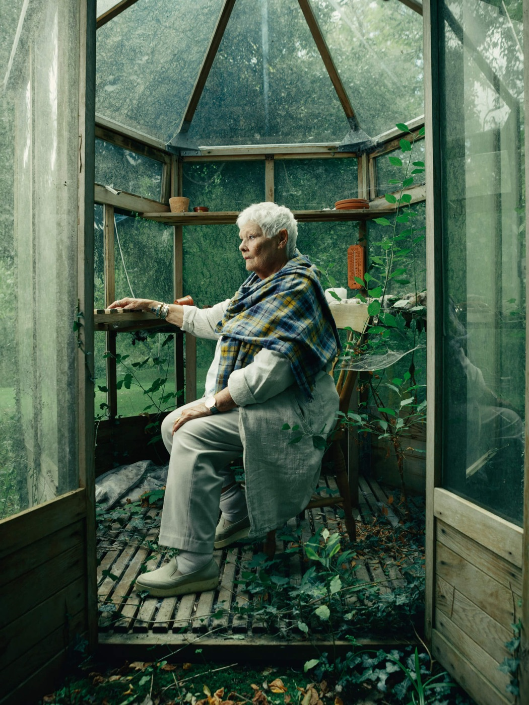
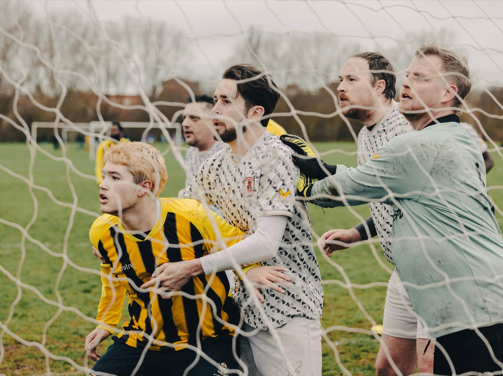
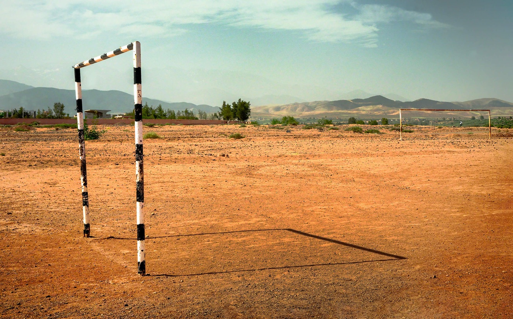
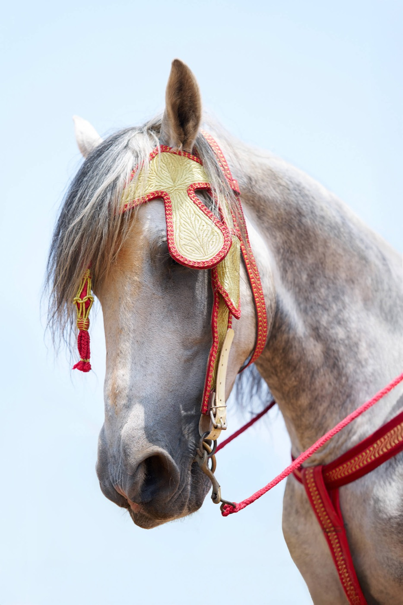
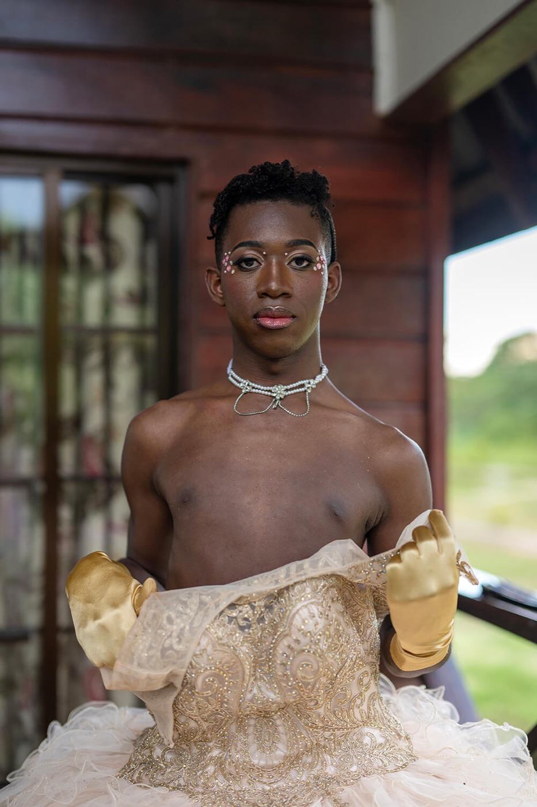
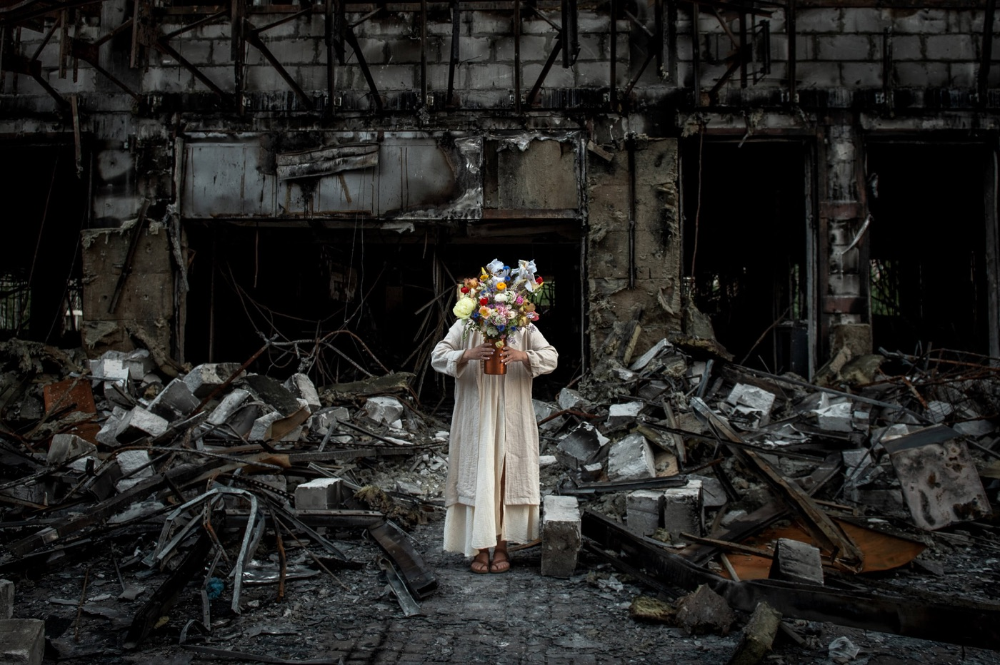

*„I am Max”, fot. Rob Palmer / AOP Open 2026.*

**AOP Open** to otwarty konkurs brytyjskiego Association of Photographers (AOP), stowarzyszenia fotografów zawodowych. Nie ma tematów ani kategorii tematycznych: liczy się oryginalność i jakość pracy. Startują na równych prawach zawodowcy, początkujący i amatorzy, a zgłosić można projekt osobisty albo pracę na zlecenie. W 2026 roku konkurs odbył się po raz szesnasty. Organizatorzy właśnie ogłosili 36 finalistów.

## Jak działa AOP Open

Prace zgłasza się w trzech formatach: pojedyncze zdjęcie (Single), seria od dwóch do pięciu zdjęć (Series) i film do 15 minut (Moving). W 2026 roku zgłoszenia przyjmowano od 10 lutego do 8 czerwca, a zdjęcia musiały powstać po 1 stycznia 2024 roku. Dopuszczone są też prace z AR, VR i CGI, ale stworzone przez człowieka.

Jury, złożone z ludzi z branży (fotografów, zleceniodawców i kuratorów), oceniało prace anonimowo. W tym roku zasiedli w nim fotografowie Joseph Ford, Louise Hagger, Carolyn Mendelsohn, Violeta Sofia i Nick Turpin, producentka Dawn Moretti oraz Julian Rodriguez.

Nagrody pieniężne to 1250 funtów za Best in Show (najlepszą pracę konkursu), 250 funtów za złoto i 100 funtów za srebro. Zwycięzcy dostają też m.in. członkostwo w AOP, roczną licencję programu Capture One (głównego sponsora) i konsultacje z branżowymi ekspertami.

Isabelle Doran, dyrektorka generalna AOP, mówi, że tak szeroki wybór gatunków pokazuje opowiadanie obrazem „w najlepszym wydaniu”. Dodaje, że jury nie wiedziało, kto jest autorem, więc odkrywanie nazwisk jest równie ciekawe jak same prace.

## Pojedyncze zdjęcia

Wśród 15 finałowych pojedynczych zdjęć są portrety znanych osób, w tym Davida Hockneya w obiektywie Frederica Arandy. Charlie Clift ma w finale dwa portrety: dziennikarki Mishal Husain i aktorki Judi Dench.

*„Dame Judi Dench”, fot. Charlie Clift / AOP Open 2026.*

Zdjęcie Roba Palmera „I am Max”, które otwiera wpis, to czarno-biała scena z ulicy: dziewczynka w szkolnym mundurku unosi nogę wysoko nad głowę, a wokół inne dzieci grają w piłkę. Pozostałe pojedyncze zdjęcia są w galerii na końcu, m.in. rozpływający się rożek lodów Jonathana Gregsona i hala w Dolomitach Tima Burgessa.

## Serie: od Surinamu po Ukrainę

Freya Najade sfotografowała niedzielne mecze amatorskich lig piłkarskich na Hackney Marshes we wschodnim Londynie. Według Fotopolis ta tradycja sięga XIX wieku.

*„The Goalmouth”, z serii „Sunday Football on the Hackney Marshes”, fot. Freya Najade / AOP Open 2026.*

Sarah Louise Ramsay pokazuje Maroko, gdzie według Fotopolis w piłkę gra się wszędzie, tylko nie na prawdziwym boisku. Na jej zdjęciu bramka stoi na kamienistej ziemi u stóp gór.

*„Morocco Mountains”, z serii „Grass Roots Mountains”, fot. Sarah Louise Ramsay / AOP Open 2026.*

Tash Hopkins w serii „Qawiyah” fotografowała muzułmanki, które uprawiają sztukę jeździecką wywodzącą się z XVI-wiecznej taktyki bitewnej.

*Z serii „Qawiyah”, fot. Tash Hopkins / AOP Open 2026.*

Hannah Maule-ffinch pokazuje społeczność LGBTIQ+ w dżungli Surinamu. Tytuł serii, „Becoming Vergey”, i podpisy zdjęć mówią o przemianie osoby o imieniu Vergey.

*„Vergey transforms”, z serii „Becoming Vergey, Suriname”, fot. Hannah Maule-ffinch / AOP Open 2026.*

Natalia Sharomova sfotografowała kwiaciarkę, która prowadzi swój interes w czasie wojny w Ukrainie. Tytuł serii wyjaśnia, o co w niej chodzi: „To nie jest historia o kwiatach. To historia kobiety, która postanowiła nie odkładać życia na później”.

*„Flowers on Ashes”, z serii „This is not a story about flowers. It is a story about a woman who chose not to postpone life”, fot. Natalia Sharomova / AOP Open 2026.*

W finale serii są też m.in. Ellie Ramsden („The Elvies”), Etienne Perrone („Dreams Happen After Dark”), Kristina Varaksina („In Our Skin”) i Laurie Norris-Broughton. Ich zdjęcia są w galerii.

## Filmy

W formacie Moving do finału weszły cztery filmy:

- **„The Weight of a Wig”** (reż. Joe Hart) o mistrzostwach świata w tańcu irlandzkim w Dublinie, pokazanych od kulis, w portretach i rozmowach.
- **„Table to Table”** Terry'ego Grahama: kawiarnia jako scena, połączenie filmu, fotografii i słowa mówionego.
- **„Inclusion Exclusion”** Caroline Clark: dzieci ze specjalnymi potrzebami edukacyjnymi czytają fragmenty prawdziwych listów odmawiających im miejsca w szkole.
- **„El Rocío – The Faith and the Feeling”** Charliego Keya o pielgrzymce do andaluzyjskiej wioski El Rocío.

## Galeria finalistów AOP Open 2026

Kliknij zdjęcie, żeby je powiększyć. Strzałkami przejdziesz do kolejnych.

<!-- galeria -->

## Wystawa i kolejna edycja

Zwycięzców złota i srebra AOP ogłosi 28 stycznia 2027 roku na otwarciu wystawy w Fujifilm House of Photography w Londynie. Wystawę prac finalistów będzie można oglądać od 29 stycznia do 14 marca 2027 roku. Według Fotopolis zgłoszenia do następnej edycji ruszą w lutym.

Wszystkie finałowe prace są na [stronie AOP Awards](https://www.aopawards.com/2026-aop-open-award-finalists-single-entries/).

Jeśli lubisz takie zestawienia, zajrzyj też do wpisów o [Zdjęciach Roku 2026 National Geographic](/blog/national-geographic-zdjecia-roku-2026.html) i [Nature Photographer of the Year 2026](/blog/nature-photographer-of-the-year-2026-anna-terlecka.html).

## Źródła

- [AOP Awards: 2026 AOP OPEN Award Finalists](https://www.aopawards.com/2026-aop-open-award-finalists-single-entries/)
- [AOP Awards: AOP OPEN 2026, zasady i nagrody](https://www.aopawards.com/aop-open/)
- [Fotopolis.pl: Bez tematów i kategorii, po prostu dobre zdjęcia. Oto finaliści AOP Open 2026](https://www.fotopolis.pl/inspiracje/galerie/40036-bez-tematow-i-kategorii-po-prostu-dobre-zdjecia-oto-finalisci-aop-open-2026) (Maciej Luśtyk)

Fotografie pochodzą z materiałów Fotopolis.pl i należą do ich autorów oraz Association of Photographers.
