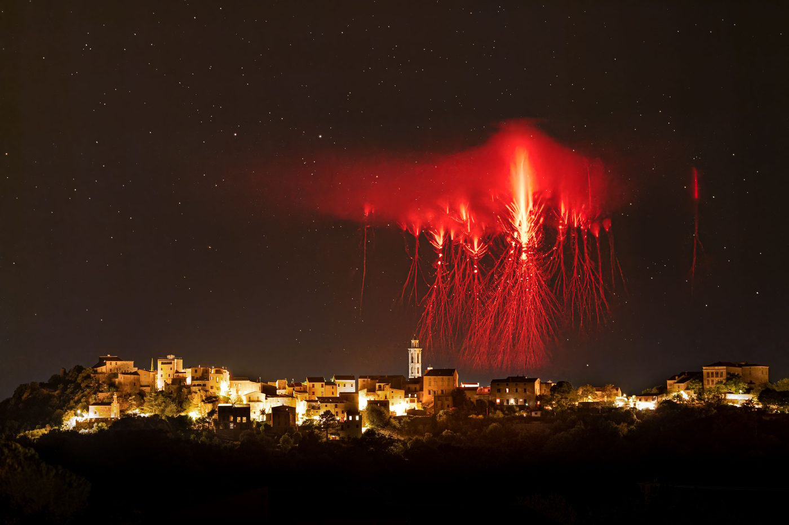
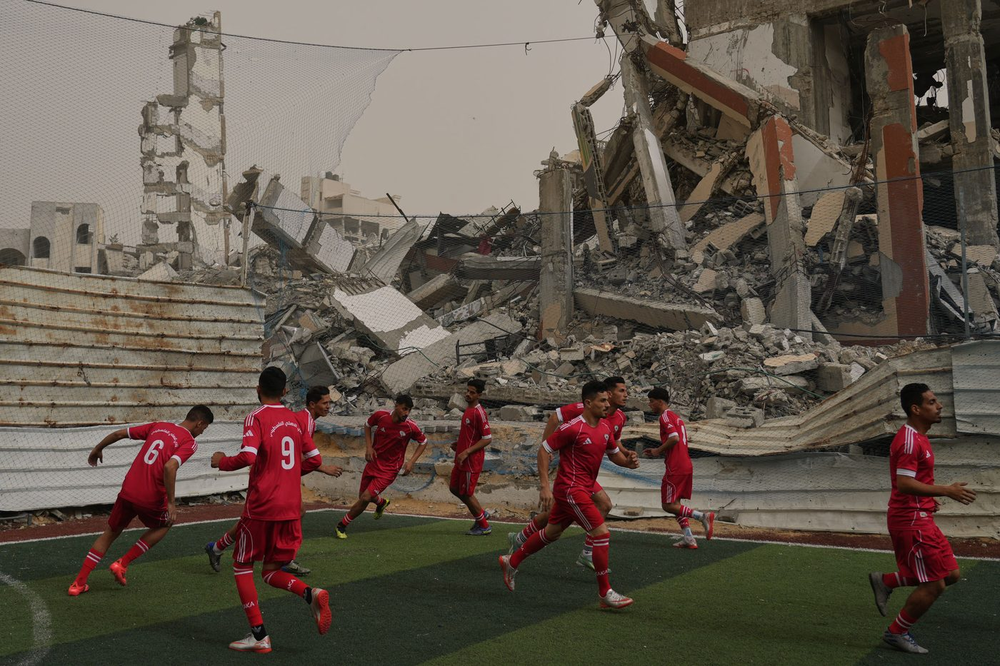
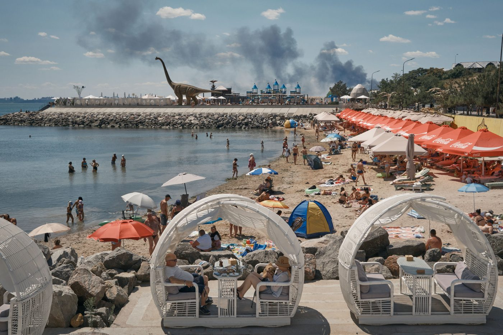
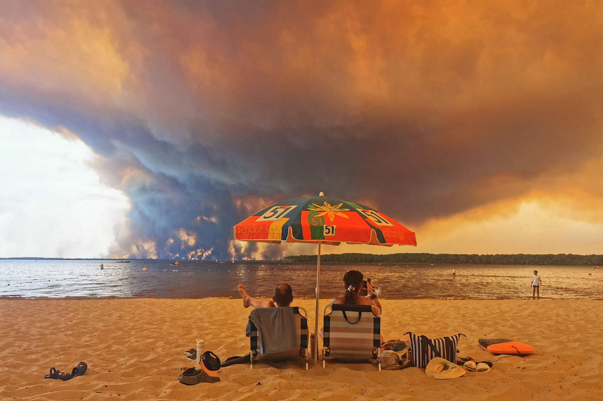
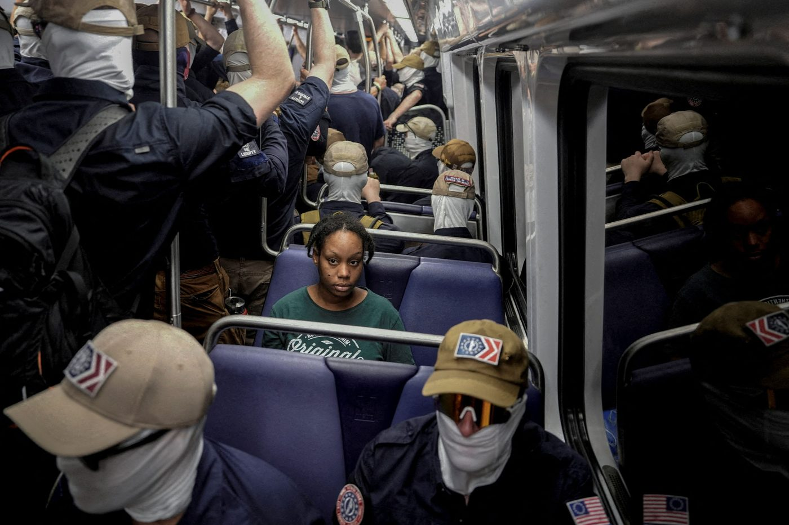
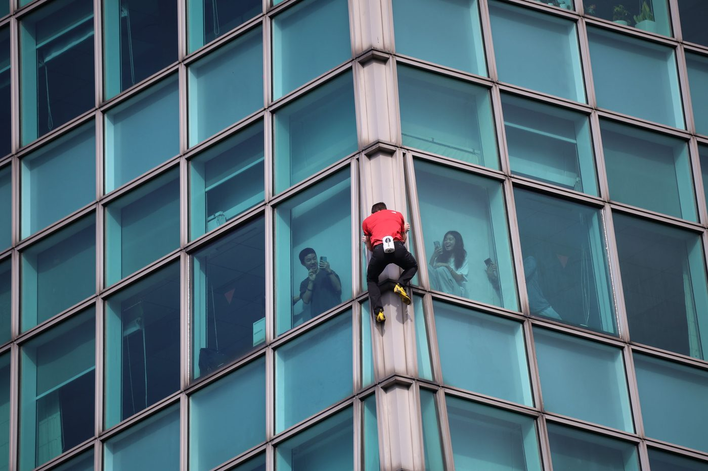
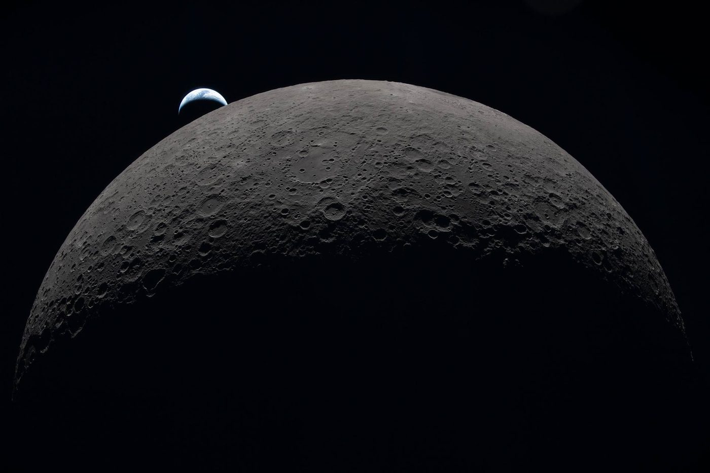
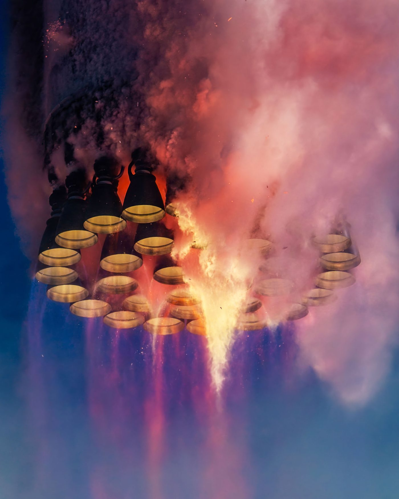

*Burza nad zatoką nowojorską widziana z Jersey City, 3 lipca. Fot. Stephen Wilkes / TIME's Top 100 Photos of 2026.*

**TIME opublikował 24 listopada swoje doroczne zestawienie „Top 100 Photos of 2026”.** To nie konkurs ani ranking od najlepszego do najsłabszego zdjęcia, tylko wybór redaktorów działu fotograficznego magazynu: sto kadrów, które ich zdaniem najlepiej pokazują ten rok. Są wśród nich wojny i protesty, katastrofy i ekstremalna pogoda, sport, misje kosmiczne, ale też zwykłe życie.

Zestawienie otwiera zdjęcie Stephena Wilkesa: letnia burza nad zatoką nowojorską, w której panorama Manhattanu prawie rozpływa się w deszczu i mgle.

## Ktoś tam był

Wstęp do zestawienia napisał Karl Vick. Jego główna myśl jest taka, że w czasach obrazów generowanych przez sztuczną inteligencję wciąż możemy wierzyć własnym oczom, bo za każdym z tych zdjęć stoi fotoreporter, który był na miejscu, podniósł aparat i nacisnął spust migawki. Vick zauważa, że część kadrów wygląda jak efekty specjalne, choć wszystkie pokazują to, co naprawdę się wydarzyło.

Przykłady podaje sam. Jeden to psy, które zdają się znikać:

*Wystawcy z dalmatyńczykami czekają na ocenę na wystawie Crufts w Birmingham, 7 marca. W tym roku pokazano tam ok. 18 tysięcy psów. Fot. Hannah McKay / Reuters.*

Drugi przykład to wyładowanie elektryczne nad starym kamiennym miasteczkiem:

*„Czerwony duszek” (red sprite) nad Montemaggiore na Korsyce, 16 września. Fot. Florian Riou.*

Florian Riou przez kilka dni śledził burze i wyliczał, skąd będzie widać zjawisko. Wyładowanie powstało nad burzami w okolicy Barcelony, ponad 500 km od miejsca, w którym stał. Takie zjawiska pojawiają się ok. 50–90 km nad Ziemią, a czerwony kolor dają im cząsteczki azotu w górnych warstwach atmosfery.

## Wojny i plaże w cieniu dymu

Pierwsze zdjęcie listy pochodzi z Gazy. Palestyńska federacja piłkarska zrobiła boisko, uprzątając gruz i kładąc używaną sztuczną trawę. Grają na nim lokalne drużyny i zawodnicy po amputacjach. Główny stadion w Gazie został zrównany z ziemią w czasie wojny Izraela z Hamasem i służył jako obóz namiotowy dla przesiedlonych.

*Piłkarze Al-Ahly rozgrzewają się przed meczem z Gaza Sports Club w Gazie, 14 lutego. Fot. Jehad Alshrafi / AP Photo.*

Z wojny w Ukrainie są m.in. zdjęcia z Kijowa, Charkowa i Odessy. W Odessie ludzie odpoczywają na plaży, a za nimi unosi się dym po rosyjskim ataku rakietowym.

*Plaża na skraju Odessy w czasie alarmu przeciwlotniczego, 29 lipca. Fot. Kostiantyn Liberov / Libkos / Getty Images.*

Plaża i dym pojawiają się też we Francji. Pożar w północnej części Basenu Arkachońskiego strawił do tego dnia ponad 3400 hektarów, a z okolicy ewakuowano ponad 20 tysięcy mieszkańców i turystów.

*Plaża Moutchic w Lacanau w południowo-zachodniej Francji, 24 lipca. Fot. Maximilien Lamy / AFP / Getty Images.*

W zestawieniu są też wojna z Iranem, protesty w Teheranie, migranci z Malawi w RPA, a także zdjęcie Nicolása Maduro opublikowane przez Donalda Trumpa 3 stycznia, po schwytaniu wenezuelskiego prezydenta przez siły USA. Jest również zdjęcie ze spotkania Trumpa, Xi Jinpinga i Władimira Putina w Shenzhen (w galerii poniżej).

## Ameryka: ICE i 250. rocznica

Dużo miejsca TIME poświęca amerykańskiej polityce migracyjnej. Między grudniem 2025 a lutym 2026 w rejon Minneapolis wysłano ok. 3 tysięcy agentów ICE i CBP (służby celnej i granicznej). W styczniu zginęło tam z rąk federalnych agentów dwoje obywateli USA, Renee Good i Alex Pretti. TIME pokazuje protesty, zatrzymania i ośrodki detencyjne.

*Zatrzymanie protestującego na zaśnieżonej Nicollet Avenue w Minneapolis, 24 stycznia. Tego samego dnia, ok. przecznicę dalej, federalni agenci zastrzelili Alexa Prettiego. Fot. David Guttenfelder / The New York Times / Redux.*

Karl Vick wymienia we wstępie zdjęcie z Waszyngtonu zrobione 4 lipca, w 250. rocznicę niepodległości USA: zamaskowani członkowie skrajnie prawicowej grupy Patriot Front w wagonie metra, a między nimi samotna czarnoskóra pasażerka.

*Metro w Waszyngtonie, 4 lipca 2026. Fot. Cheney Orr / Reuters.*

## Sport i kosmos

Sport to m.in. igrzyska Milano Cortina, finał mundialu Hiszpania–Argentyna, Super Bowl i mistrzostwo NBA dla Knicksów. Jedno z najbardziej zawrotnych zdjęć pokazuje Alexa Honnolda na ścianie wieżowca Taipei 101, na który wspiął się gołymi rękami.

*Alex Honnold na Taipei 101, 25 stycznia. Fot. CFOTO / Future Publishing / Getty Images.*

Z kosmosu są dwa mocne zdjęcia. Pierwsze zrobiła załoga Artemis II podczas siedmiogodzinnego przelotu nad Księżycem 6 kwietnia. Na pokładzie byli astronauci NASA Reid Wiseman, Victor Glover i Christina Koch oraz Jeremy Hansen z Kanadyjskiej Agencji Kosmicznej.

*Niewidoczna z Ziemi strona Księżyca na jednym z pierwszych zdjęć z przelotu Artemis II, 6 kwietnia. Fot. NASA.*

Drugie to start Starshipa V3, pierwszy lot najpotężniejszej rakiety świata. Andrew McCarthy ustawił aparat wyzwalany dźwiękiem ok. 90 metrów od stanowiska startowego i złapał silniki Raptor 3 w chwili zapłonu.

*Start Starshipa V3 w bazie SpaceX Starbase w Boca Chica w Teksasie, 22 maja. Fot. Andrew McCarthy.*

Na liście są też Światowe Igrzyska Robotów Humanoidalnych w Pekinie, osunięcie lodowca w Nepalu, trzęsienia ziemi w Kolumbii i Wenezueli, powodzie w Niemczech i fale El Niño na wybrzeżu Kalifornii.

## Galeria: 18 kolejnych zdjęć z zestawienia

Kliknij zdjęcie, żeby je powiększyć. Strzałkami przejdziesz do kolejnych.

<!-- galeria -->

## Całe zestawienie

Wszystkie zdjęcia z obszernymi podpisami są na [stronie TIME](https://time.com/article/2026/11/24/times-top-100-photos-of-2026/).

Jeśli lubisz takie podsumowania roku, zajrzyj też do wpisu o [Zdjęciach Roku 2026 National Geographic](/blog/national-geographic-zdjecia-roku-2026.html).

## Źródła

- [TIME: TIME's Top 100 Photos of 2026](https://time.com/article/2026/11/24/times-top-100-photos-of-2026/) (TIME Photo Department, wstęp Karl Vick)
- [Fotopolis.pl: TIME prezentuje 100 najważniejszych zdjęć 2026 roku](https://www.fotopolis.pl/inspiracje/galerie/40045-time-prezentuje-100-najwazniejszych-zdjec-2026-roku) (Krzysztof Mularczyk)

Fotografie pochodzą ze strony magazynu TIME i należą do ich autorów oraz wskazanych agencji.
